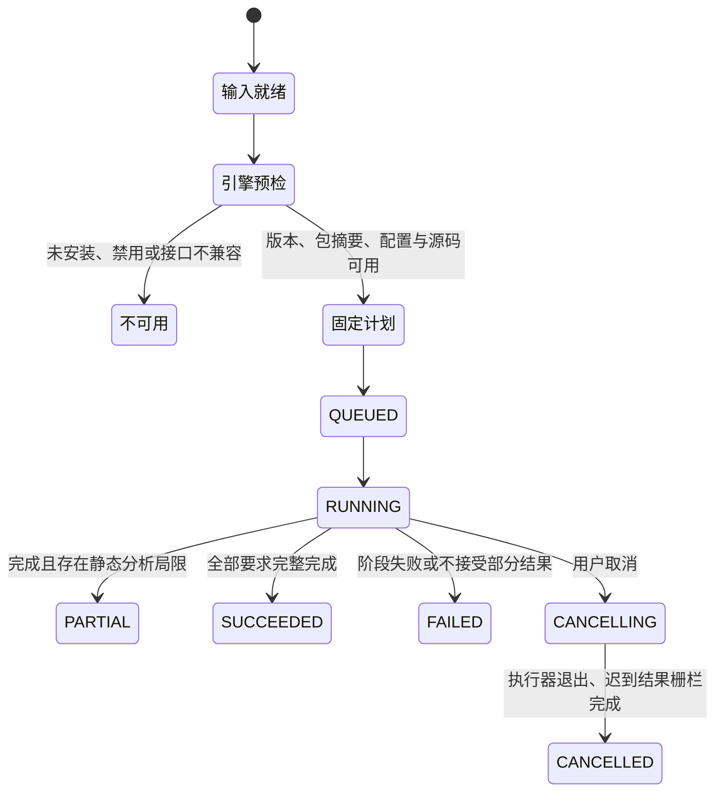

# 项目主图谱引擎

项目“一键图谱分析”的正式默认方案为 `codexploit.default-analysis@2.2.2`，全部四阶段固定使用 `codexploit.joern@2.3.4`，上游 Joern 固定为 4.0.664。安装插件不会重写历史计划；新运行使用新默认，活动运行继续固定计划。内置 Go 插件保留历史兼容与显式自定义工作流用途，不再作为项目入口的备用解析器。

## 一条主链路

| 节点 | 操作 / 层级 | 固定输入与输出 |
| --- | --- | --- |
| parse | Joern parse / parse | 冻结源码 → 各匹配语言的原生 CPG、标准代码事实；默认 AUTO |
| semantic | Joern taint / semantic | 同一源码、代码事实及全部对应 CPG → 规则摘要、安全事实与原始污点轨迹 |
| paths | Joern paths / path.generate | 同一代码、安全事实和轨迹 → data_flow 候选，绑定准确 graph_pins |
| enhance | Joern enhance / path.enhance | 原始候选 → 原样保留的候选子集、排名及筛选账本 |
| $publish | 宿主发布 | 标准事实进入不可变知识版本；同一引擎投影进入图谱、审查路径与任务 |
| $analyze | 可选 Agent | 使用投影后的同一份路径、源码、原始证据引用和义务清单 |

前三阶段不再次调用其他图谱引擎。AST、CFG、基础数据流留在原生 CPG；审查索引只投影 Joern 已输出的文件、方法、调用与污点关系，不用内置 Go 引擎补图。文件目录作为展示分组，不冒充构建模块或依赖解析结果。

排序版本为 `joern.static-support/v2`，按 data_flow=1、call_reachability=0.4、hypothesis=0.1 排优先级，并加入最多 0.5 的版本化 Java sink 审查提示；同分按路径 ID 排序。这不是漏洞严重程度或可利用概率。默认最多保留 1000 条，预算筛除的候选保留在原始产物和筛选账本中。宿主验证保留候选逐条不变，图谱 pin 不变，排名连续，全部候选都有去向。Java sink 目录、全量命中与 80/20 分区见 [Java sink catalogue](java-sink-catalog.md)。

## 运行与替换状态

预检失败返回 `503 analysis_engine_unavailable`，不创建任务或运行。预检通过不代替每次调用前后的全包完整性检查。项目页读取 `GET /api/v1/projects/{id}/analysis-engine`，显示实际就绪情况；入口仍是一个“开始图谱化分析”按钮，Agent 默认关闭。

每个阶段独立记录 invocation、operation、输入输出和终态。parse / taint / paths / enhance 的 PARTIAL 显式接受后继续，但整个运行仍是 PARTIAL；静态覆盖局限不被发布阶段的成功覆盖。失败会跳过下游，不回退到 Go 解析器。取消、暂停、重试与恢复由既有工作流状态机执行。项目停止接口须等工作流和 AnalysisRun 状态投影都落定后才报告 STOPPED，避免提前报告停止而删除仍被活动记录阻止。

同一幂等键返回原运行；存在活动运行时复用活动运行。升级后必须发起新运行才能采用新引擎，旧计划和结果不变。`AnalysisRun.engine` 持久化 provider、profile_version、插件版本、包与清单摘要；每阶段配置、规则及源快照继续由计划摘要、原始报告和产物摘要固定。运行期间禁止改写 engine pin。

宿主扩展边界为 `internal/analysisengine.Provider`：整体提供 `Workflow()` 与 `Project(Bundle)`。后续替换引擎应整体实现标准链路与审查投影，调整默认 provider 并提升默认流程版本；不为每个阶段引入可任意混搭的工具选择。独立扫描器仍可作为自定义工作流的并行节点发布自己的观察，不参与主引擎的图谱拼接。

同一版本、平台下的构建使用 `build_id = package_digest` 登记，身份为 `(plugin_id, version, os, arch, build_id)`。二进制重建产生新摘要时登记新构建；旧发布记录不改写，旧计划仍校验原包摘要。历史空 Build ID 保留兼容。`pluginpack` 输出摘要绑定的 Build ID，登记接口拒绝 Build ID 与包摘要不一致的请求。每次执行仍核验完整文件锁。

## 图谱、路径与 Agent

投影检查同一插件版本、包摘要、Scope、代码 / 安全 pin、CPG 引用、原始候选及其筛选血缘；不兼容输入明确失败。入口可信度保持 inferred；Joern 的静态 taint_flow 可以 observed，不能据此升级为“攻击者已可控”“控制已失效”或已确认漏洞。

SCG / ASG 当前查询索引成对原子替换。旧知识版本、标准文件及原始 CPG 保留；固定到被替换索引的旧查询视图会返回失效状态，不悄悄读取新版。审查路径保留实际规范化符号、ASG 关系、原始轨迹和标准产物引用，以及选择原因和评分版本。重启从固定产物重建投影，完成的 Agent 节点复用原运行。

Agent 的四条义务仍要求分别审查来源可控性、流向、控制和 sink 敏感性。缺少方法结束位置时，源码切片补入同一 Joern 图谱已经记录的调用点窗口，遵守行数、节数与内容上限。原始轨迹引用进入任务证据；数据流支持和控制未评估的说明一同传递。此接入不代表模型裁定准确率已经完成评测。

## 部署与验证

`make run` / 默认 Compose 镜像直接构建并包含封存 Joern 包，无需再额外叠加覆盖文件。首轮构建会下载锁定的上游归档并构建 PHP / Linux ARM64 Ghidra 补充组件；需要网络和较多磁盘，下载缓存有 SHA-256 校验。运行镜像使用 Debian Trixie，封存包归运行用户所有，临时工作空间为 8 GiB；每次调用复制并核验约 3 GiB 的完整包，JVM 默认堆上限 1 GiB。实际物理资源和并发需由部署环境提供。

语言、二进制输入、规则与覆盖限制见 [Joern 接口](joern.md)。AUTO 覆盖所有匹配前端；Ghidra 必须明确输入路径，不自动猜测二进制。缺少离线依赖、动态分派、外部方法语义和框架模型仍会影响结果。零条路径不代表安全。

已有真实验证：14 前端的解析矩阵；C / JavaScript / Python 参数与常量对照；一键主流程的三份 CPG、真实污点轨迹、三条审查路径与产物摘要。新增 opt-in `TestRealJoernDefaultAnalysisFeedsGraphAndAgent` 和 PostgreSQL 同名边界验证真实包到 Agent 的任务协议、源码与义务清单；其中 Agent 使用明确的测试适配器，不作为模型质量或真实漏洞裁定的证据。

## 路径预算与应用诊断（2026-10-24）

Joern 2.3.4 在 `max_flows` 到达上限时保留预算内的真实轨迹，返回 PARTIAL，原始流报告和 semantic coverage 均标记 truncated，原生证据保留。该预算不是总路径数估计；计数只表示已保留轨迹，不能宣称枚举完整。Java 目录命中的零流 sink 独立保留，不占污点流预算。上游截断继续传递到审查路径、任务和 Agent 的局限。执行、输出大小、选择器和单条轨迹预算失败仍不发布半成品。file-job 的已知失败分类保留为 invocation.error_code；不会把任意 stderr 当作诊断返回。

项目主 Agent 可通过私有、只读 MCP 查询源码、导入、分析/工作流、插件、任务、路径、Agent 运行、发现、报告、产物与存储 readiness。源码按冻结树读取，不依赖图谱发布；图查询失败应先核对来源与分析状态。该能力不开放任意 Shell、配置修改或删除。详见 [MCP 工具](mcp-tools.md)。
