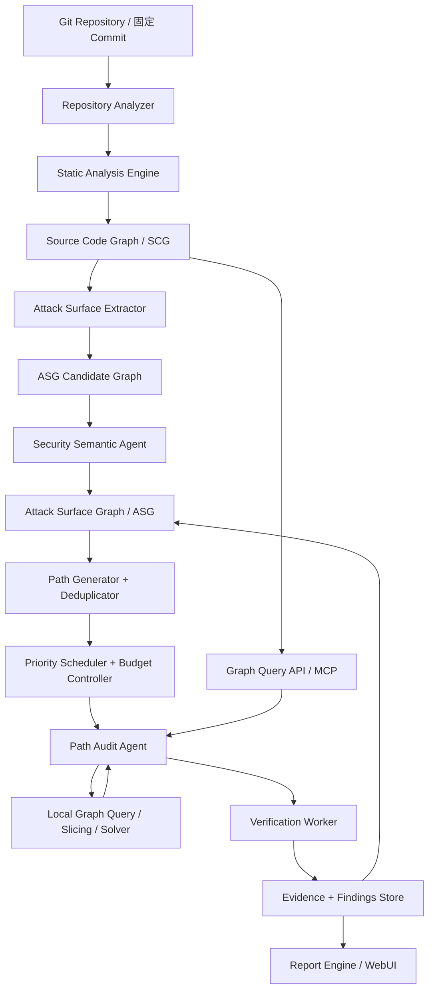
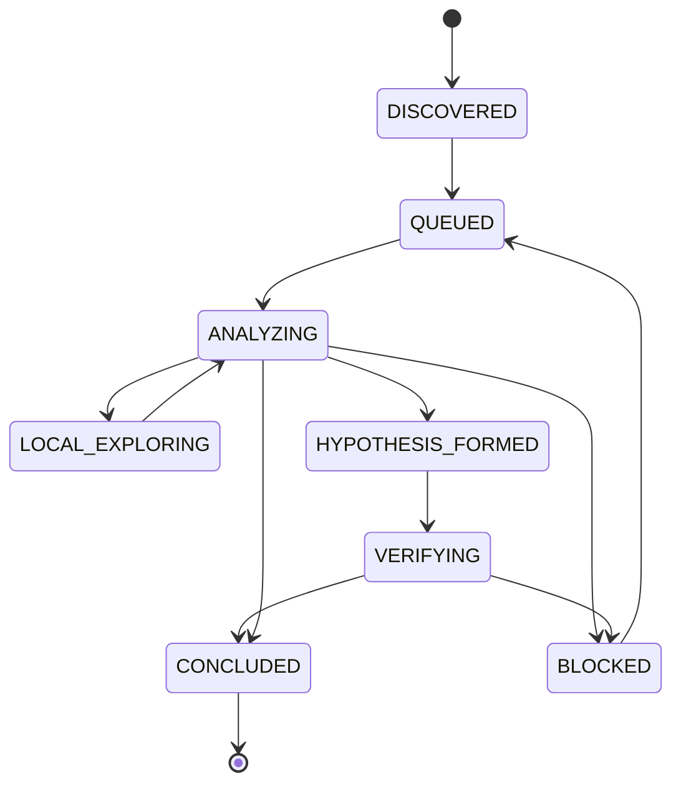

# Codexploit 系统设计方案

> 版本：v0.1（架构草案）  
> 定位：静态分析驱动、双图谱建模、路径优先的 AI 代码安全审计平台  
> 原则：传统工具优先，Agent 按需介入；所有发现可追溯、可验证、可恢复。

## 1. 目标与边界

Codexploit 将源码结构化为源码图谱（SCG），从中提取攻击面候选，再通过安全语义分析构建攻击面图谱（ASG）。审计任务以攻击路径（AuditPath）为基本单位，由确定性调度器选择路径；Agent 仅对难以由规则、静态分析和求解器解决的部分进行语义推理，允许受预算约束的局部发散。最终通过隔离验证形成证据闭环。

### 目标
- 降低 LLM Token 消耗与重复工具调用；提升单位成本的有效发现率。
- 将静态事实、Agent 假设和动态验证结论分离。
- 支持多语言、多静态分析后端、多 Agent Runtime 和增量审计。
- 支持任务暂停、恢复、审计记录回放和报告生成。

### 非目标（MVP）
- 不追求全语言的完备、精确跨过程数据流分析。
- 不允许 Agent 在未经授权的真实生产环境执行攻击验证。
- 不将静态分析未报告的路径视为安全证明。
- 不把 LLM 的隐藏思维链作为审计记录；仅记录显式假设、依据和操作结果。

## 2. 总体架构



### 分层
1. **L0 确定性层**：仓库分析、AST/CPG、路由提取、路径生成、规则扫描、去重、评分、缓存、报告模板。
2. **L1 有界分析层**：局部污点分析、程序切片、约束求解、隔离测试、验证证据采集。
3. **L2 语义 Agent 层**：业务语义、安全边界识别、未知漏洞假设、局部探索决策、证据冲突裁决。
4. **控制面**：工作流状态机、Agent Runtime 适配、预算、权限、审计日志。
5. **展示面**：项目、双图谱、路径队列、Agent 事件、漏洞和报告。

## 3. 核心数据模型

### 3.1 SCG：源码图谱

**定义**：由静态分析工具产生的模块化代码路径与关系图；包含可验证的代码结构事实及其分析限制。

- 节点：`Repository`、`Module`、`File`、`Symbol`、`CallSite`、`ControlPoint`、`SourceLocation`。
- 边：`CONTAINS`、`IMPORTS`、`CALLS`、`FLOWS_TO`、`CONTROLS`、`REFERENCES`。
- 关键属性：`snapshot_id`、`symbol_id`、`language`、`file`、`line_start/end`、`engine`、`analysis_version`、`resolution_status`。
- 两级视图：模块依赖图；模块内部函数/调用/关键分支路径图。
- 关键策略：不枚举所有执行路径；预建符号和关键边，深度路径按需查询并缓存。

**事实限定**：调用边可能是静态近似；反射、动态分派、框架隐式调用、外部依赖可能导致缺边或伪边。每条关系必须保留来源和分析完整性信息。

### 3.2 ASG：攻击面图谱

**定义**：面向安全语义的路径图；基于 SCG、配置、框架规则、外部暴露信息及 Agent 推断形成。

- 节点：`EntryPoint`、`AttackerControlledInput`、`TrustBoundary`、`SecurityControl`、`SensitiveOperation`、`Asset`、`Hypothesis`。
- 边：`REACHES`、`CROSSES`、`PROTECTED_BY`、`MAY_AFFECT`、`DERIVED_FROM`、`SUPPORTED_BY`、`VERIFIED_BY`。
- 属性：`evidence_status`（observed/inferred/verified/refuted）、`confidence_kind`、`source_refs`、`snapshot_id`、`graph_version`。
- ASG 节点与 SCG 节点多对多关联；**ASG 不得覆盖 SCG 静态事实**。
- 更新机制：新情报、验证结果、代码变更触发局部重评估；保留历史版本。

### 3.3 AuditPath：核心任务单元

```json
{
  "path_id": "ASG-PATH-001",
  "snapshot_id": "<git-commit>",
  "asg_version": 3,
  "entry_node_id": "ASG-ENTRY-01",
  "target_node_id": "ASG-SINK-09",
  "scg_refs": ["SCG-SYM-17", "SCG-SYM-38"],
  "status": "ANALYZING",
  "hypotheses": ["HYP-001"],
  "evidence_ids": ["EV-001"],
  "budget": {"max_depth": 2, "max_branches": 4, "max_tool_calls": 30},
  "score_version": 1
}
```

### 3.4 证据对象

`Evidence` 记录：类型（源码/静态查询/规则/运行日志/测试）、产生工具、工具版本、源码位置、内容哈希、验证环境、时间、关联路径/假设。发现对象 `Finding` 与证据分离，状态包括 candidate、confirmed、refuted、inconclusive。验证未复现不自动等于不存在。

## 4. 模块设计

| 模块 | 职责 | 主要输入 | 主要输出 | MVP 实现 |
|---|---|---|---|---|
| Repository Manager | 克隆、固定 Commit、快照、增量差异 | Git URL / Commit | Snapshot | Go + Git |
| Repository Analyzer | 语言、依赖、构建和框架识别 | Snapshot | Project Manifest | 文件规则、依赖解析 |
| SCG Builder | AST/CPG、符号、调用与数据流 | Snapshot | SCG | Tree-sitter + Joern |
| Graph Service | 图查询、路径检索、缓存、源码切片 | SCG/ASG Query | JSON 证据 | Go API + MCP |
| Attack Surface Extractor | 路由、RPC、CLI、Source/Sink、控制点 | SCG + 配置 | ASG Candidate | 框架规则、静态分析 |
| Security Semantic Agent | 信任边界、业务语义、候选修正 | ASG Candidate + 切片 | ASG 修订建议 | 可插拔 Runtime |
| Path Generator | 候选路径枚举、约束、去重 | ASG + SCG | AuditPath | 有界图遍历 |
| Risk & Value Scorer | 风险、证据、新颖性、成本估计 | Path Features | Score | Go 规则评分 |
| Orchestrator | 状态机、租约、重试、恢复、资源控制 | AuditPath | Task/Events | Go + PostgreSQL |
| Budget Controller | Token、时间、工具调用与探索限制 | 预算、路径状态 | 执行许可 | Go |
| Path Audit Agent | 漏洞假设、受限局部探索 | Path Slice + Evidence | Hypothesis/Request | Claude Code 首版 |
| Static Rule Scanner | 已知危险模式和依赖风险 | Snapshot | Finding Candidate | Semgrep / OSV-Scanner |
| Verification Worker | 隔离验证、日志、结果采集 | 验证计划 | Verification Result | Docker 隔离 |
| Finding & Evidence Store | 归档、去重、追溯、版本化 | 全部分析事件 | 结构化发现 | PostgreSQL + 文件存储 |
| Report Engine | SARIF/JSON/Markdown/HTML 报告 | Findings | Report | 模板引擎 |
| WebUI | 双图谱、路径审计、成本、回放 | API/SSE | 交互界面 | React + TypeScript |

## 5. 传统工具与 Agent 的边界

**优先传统工具**：AST/符号索引、调用图/数据流、框架入口提取、污点规则、Source/Sink 候选、路径遍历、程序切片、去重、优先级、已知漏洞扫描、依赖/密钥扫描、隔离环境创建、模板报告。

**Agent 按需执行**：识别业务意图和复杂授权语义；提出未知漏洞假设；解释互相矛盾的证据；申请局部扩展；设计规则和现有测试无法覆盖的验证策略。

调用门控：先查缓存 → 图查询 → 静态规则/污点 → 有界求解或测试 → 仍无法判断且预期收益足够时调用 Agent。任何工具的“无结果”均不能直接当作安全证明。

## 6. 路径生成、去重与权重算法

### 6.1 候选生成
- 从外部输入节点、消息消费入口、文件/CLI 输入等 Source 出发，查找通往敏感 Sink 的候选路径。
- 分别保存调用可达性与数据传播证据；仅调用链不证明污点传播。
- 采用有界 BFS / DFS、k-shortest paths、控制边界过滤；限制每个入口候选数。
- 使用安全控制节点和信任边界作为路径分组依据，避免简单枚举导致路径爆炸。

### 6.2 去重与覆盖
- 精确去重：`snapshot + entry + sink + security-boundary-sequence + path-signature`。
- 相似聚类：SCG 节点集合 Jaccard、共享 Sink、相同安全边界和规则命中。
- 调度采用**边际覆盖**：优先选择对已调度路径新增关键节点/边最多的候选，防止多 Agent 重复工作。

### 6.3 启发式评分（初始版本）

所有特征归一化到 `[0,1]`：

\[
R = 0.25E + 0.20I + 0.20S + 0.20T + 0.15B
\]

`E` 暴露程度、`I` 潜在影响、`S` 输入可控程度、`T` 信任边界、`B` 业务敏感度。

\[
C = 0.35F + 0.25D + 0.25V + 0.15Q
\]

`F` 可达性证据、`D` 数据流证据、`V` 安全控制疑点证据、`Q` 分析质量。`C` 仅代表证据支持度，**不是漏洞概率**。

\[
U = 0.40N + 0.35G + 0.25H
\]

`N` 新颖性、`G` 预期信息增益、`H` 共享组件复用价值。

\[
P = 100 \times \frac{(0.55R + 0.25C + 0.20U)D_{dup}}{1 + 0.30K}
\]

`D_dup` 为重复/已审计折扣，`K` 为预计成本。以上系数均是待标定的 MVP 启发式参数，非统计概率。评分、特征、权重与规则版本均须持久化以支持回放。

### 6.4 动态更新
事件 `source_discovered`、`dataflow_confirmed`、`control_identified`、`hypothesis_refuted`、`verification_completed`、`snapshot_changed` 触发重算。已验证与已排除路径退出常规队列；新 Commit 使相关证据失效并重新入队。保留约 15%–25% 初始探索预算给低覆盖路径（需实验校准）。

## 7. 路径审计状态机与有限发散



- Agent 只可沿当前路径及有界邻域查询；默认探索深度 2、最多 4 个活跃分支、最多 30 次工具调用（示例参数）。
- 跨模块、跨安全边界扩展必须提交 `EXPAND_REQUEST`，附理由、目标、成本和证据，由 Orchestrator 决定。
- 每次探索记录 `path_id`、`hypothesis_id`、工具、参数摘要、证据引用、结果和预算消耗。
- `PAUSED`、`FAILED`、`CANCELLED`、`INTERRUPTED` 是执行生命周期状态，独立于路径审计结论。
- Agent 不直接决定最终验证状态；验证引擎返回 `CONFIRMED`、`REFUTED`、`INCONCLUSIVE` 或 `BLOCKED`。

## 8. API 与 MCP 接口

### Graph Query MCP（MVP）

```text
list_symbols(snapshot_id, module_id?)
get_symbol(snapshot_id, symbol_id)
get_callers(snapshot_id, symbol_id, depth, limit)
get_callees(snapshot_id, symbol_id, depth, limit)
find_dataflow_paths(snapshot_id, source_id, sink_id, limit)
get_code_slice(snapshot_id, path_id, direction, max_lines)
```

建议额外提供只读 `get_attack_path(path_id)` 和 `get_evidence(evidence_id)`。所有查询强制 `snapshot_id`、返回来源、完整性说明、节点/边 ID 与行号；限制返回规模和执行时间。初期不允许 Agent 执行任意 Joern Scala/CodeQL 查询。

### 关键 REST API

```text
POST   /api/projects
POST   /api/projects/{id}/snapshots
POST   /api/audits
GET    /api/audits/{id}
GET    /api/audits/{id}/events      # SSE
GET    /api/audits/{id}/paths
GET    /api/paths/{id}
POST   /api/paths/{id}/pause
POST   /api/paths/{id}/resume
POST   /api/paths/{id}/expand-requests
GET    /api/findings
GET    /api/reports/{id}
```

写操作须做权限校验、乐观并发控制与幂等键处理。

## 9. 数据存储与缓存

- **PostgreSQL**：项目、快照、任务、路径、状态、评分、假设、发现、图谱元数据和事件索引。
- **原生 CPG/文件对象存储**：Joern 分析产物、源码切片、测试日志、报告、证据附件；不强制 Neo4j。
- **追加式事件日志**：可回放任务状态变化与 Agent 操作摘要。
- **缓存键**：`hash(snapshot_id, module_id, query_type, query_args, engine_version, ruleset_version)`。
- 跨 Commit 缓存复用必须通过依赖影响分析；未改动的文件也可能受跨模块变更影响。
- 证据不可静默覆盖；通过新版本/新事件追加修正。

## 10. Agent Runtime 设计

```go
// 示意接口，不绑定具体 SDK。
type AgentRuntime interface {
    Start(ctx context.Context, req AgentRequest) (RunID, error)
    Events(ctx context.Context, id RunID) (<-chan AgentEvent, error)
    Cancel(ctx context.Context, id RunID) error
    Resume(ctx context.Context, checkpoint Checkpoint) (RunID, error)
}
```

第一版采用 Claude Code 适配器，后续支持 DSH、OpenCode 或自研 Runtime。若底层 CLI 不支持精确恢复，则由 Orchestrator 利用持久化证据和任务阶段重建上下文，不承诺恢复任意中间推理状态。Agent 不负责启动或监管其他 Agent；进程、心跳、租约、重试和预算由调度器负责。

## 11. 隔离验证与安全边界

- 只针对授权仓库、授权目标与隔离测试环境进行验证。
- Worker 使用最小权限、资源限额、超时、受控网络、临时凭据和只读源码快照。
- 禁止将宿主机 Docker Socket 直接暴露给 Agent；高风险测试需人工批准。
- 验证环境、Commit、测试输入摘要、执行日志和退出状态绑定到证据对象。
- 未复现与无法验证分别标注，不能等同于无漏洞。

## 12. WebUI 设计

1. **项目与快照**：仓库、语言、依赖、最近分析时间、静态分析覆盖范围。
2. **SCG 视图**：模块级图谱 → 函数调用路径 → 代码位置与数据流证据。
3. **ASG 视图**：入口、信任边界、安全控制、敏感操作、候选路径及证据状态。
4. **路径审计工作台**：优先级、预算、状态、局部发散分支、显式推理摘要、工具调用。
5. **Agent 监控**：心跳、当前路径、Token、工具耗时、暂停/恢复。
6. **漏洞中心**：候选/确认/排除/不确定、关联路径、证据、验证记录。
7. **报告与评测**：Markdown/HTML/SARIF、历史版本差异、准确率、覆盖和成本。

## 13. MVP 交付阶段

| 阶段 | 交付内容 | 验收标准 |
|---|---|---|
| P0 基础分析 | Git 快照、语言识别、SCG、Graph API | 固定 Commit 可重复构图与查询 |
| P1 攻击面 | 路由/Source/Sink 提取、ASG Candidate、路径生成 | 候选路径均可回溯到 SCG 证据 |
| P2 路径调度 | 去重、评分、优先队列、预算、事件日志 | 相似路径避免重复调度；可重放评分 |
| P3 Agent 审计 | Skill Adapter、Path Agent、局部探索 | Agent 严格受路径/预算限制，输出结构化假设 |
| P4 验证与报告 | 隔离 Worker、证据、报告 | 漏洞结果与环境、Commit、证据关联 |
| P5 增量优化 | 变更影响、缓存、基准测试 | 比较全量/增量耗时、Token 与漏报变化 |

建议先支持一种语言/框架（例如 Go + Gin，或 Python + FastAPI）完成端到端闭环，再扩展多语言；Joern 与具体语言前端的适配能力需先验证。

## 14. 评测指标与风险

**指标**：已知漏洞召回率、候选发现准确率、验证完成率、首个有效发现时间、单位有效发现 Token/计算成本、路径覆盖、跨版本增量耗时、崩溃恢复正确率。

**主要风险及应对**：
- 静态图不完整 → 记录分析限制，允许 Agent 申请原始代码与动态证据。
- ASG 假设被误当事实 → 三态/多态证据模型，强制来源关联。
- 路径爆炸 → 边界感知去重、候选数限制、按需切片。
- 过度压缩上下文导致漏报 → 允许按需扩大切片，评测召回率。
- 评分偏置导致盲区 → 探索预算、低覆盖抽样、定期重标定。
- 多 Agent 重复工作 → 任务租约、路径签名、边际覆盖调度。
- 工具输出与 Agent 输出不可信 → Schema 校验、权限隔离、证据验证。

## 15. 关键架构决策总结

1. **SCG 是工具生成的代码事实层，ASG 是安全语义层，AuditPath 是调度单元。**
2. **传统分析优先**：AST/CPG、路径生成、切片、去重、评分、规则检测、验证执行均不依赖 LLM。
3. **Agent 有界推理**：只处理复杂语义、未知漏洞假设和必要的局部探索。
4. **事件驱动、可恢复**：状态机与证据存储独立于 Agent 会话。
5. **验证闭环**：每个结论必须能回溯到 Commit、路径、工具和证据。
6. **先闭环再扩展**：先打通 SCG → ASG → AuditPath → Evidence，再优化多 Agent 与图谱可视化。

---

*Codexploit — Map the Code. Trace the Attack. Verify the Evidence.*
