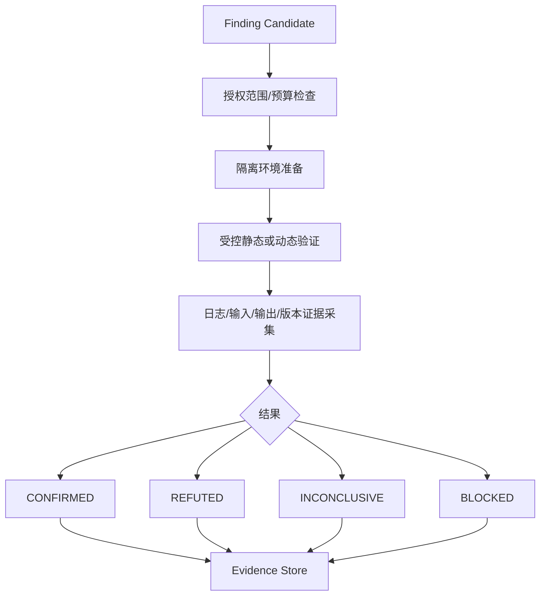

# Codexploit 实现流程与工程实践 Tips

> 版本：v0.1 · 2026-10-16  
> 配套文档：`codexploit_design.md`  
> 定位：面向研发落地的实施手册，而非第二份架构概述。

## 0. 开发总原则

1. **确定性工具优先**：能通过 AST、静态规则、图算法、程序切片和约束求解完成的，不调用 Agent。
2. **事实与假设分离**：SCG 存储分析器提供的结构/语义关系；ASG 存储候选攻击面、业务语义与推断；Evidence 记录来源及验证状态。
3. **路径是调度单位**：Agent 只是执行器，`AuditPath` 才是可以恢复、去重、评分、复核的持久对象。
4. **固定快照**：每次审计绑定 Git commit、分析器版本、规则版本、配置摘要。不能混用不同快照的图谱和证据。
5. **安全边界前置**：只审计授权代码；动态验证仅在隔离环境进行，默认禁止公网出站、宿主机 Docker socket 和长期凭据。
6. **可测量优先于直觉优化**：每次迭代记录耗时、Token、图谱覆盖、误报、漏报、有效发现率。

## 1. 目标 MVP 与明确非目标

### MVP 范围

- 支持 Git URL/本地仓库导入，固定 commit；优先支持 Go 或 Python 中的一种语言和一种 Web 框架（推荐先选与试验仓库一致的语言）。
- Tree-sitter 或语言原生 AST 建立模块/符号索引；Joern 作为可选深度 CPG 后端，不要求一开始打通所有语言。
- 规则提取 HTTP 入口、鉴权中间件引用、输入点、敏感操作；生成 ASG Candidate。
- 有界路径查询、路径去重、启发式排序；按需生成代码切片。
- 单 Agent Runtime 适配器，路径级预算、结构化结果、事件日志与恢复。
- 单机隔离验证 Worker、结构化证据、Markdown/JSON 报告。
- 最小 WebUI 或 CLI：导入项目、查看路径、启动审计、查看证据。

### 暂不做

- 全语言完备跨过程污点分析；任意代码路径穷举；自动向外部目标发起攻击；完全自主的漏洞确认；多节点分布式调度；复杂知识图谱可视化编辑器。

## 2. 推荐开发顺序与交付物

| 阶段 | 核心工作 | 可交付物 | 验收门槛 |
|---|---|---|---|
| P0 基线 | 选 3–5 个可授权的测试仓库、固定 commit、建立测试集与指标 | `fixtures/`, benchmark runner | 可重复运行、记录耗时与覆盖 |
| P1 仓库快照 | Git clone/checkout、依赖/语言识别、工作区隔离 | Snapshot Service | 相同 commit 生成相同快照 ID |
| P2 SCG | AST 索引、符号表、调用边、模块图；接入可选 CPG | SCG Builder + Query API | 路由到处理函数可追踪，未知边明确标记 |
| P3 攻击面 | 框架规则、Source/Sink、鉴权控制引用、候选 ASG | Extractor + Candidate Graph | 测试路由识别准确、无凭空推断 |
| P4 路径引擎 | 受约束图搜索、去重、风险/价值评分、预算队列 | AuditPath Scheduler | 不无限遍历；重复路径不重复派发 |
| P5 Agent | Skill Adapter、结构化输出、局部查询与扩展申请 | 单 Agent Runtime | 无效输出可重试，Token 有硬上限 |
| P6 验证与证据 | 隔离运行、测试模板、日志采集、报告 | Evidence Store + Verifier | 能区分确认/反证/不确定/阻塞 |
| P7 产品化 | SSE、UI、增量缓存、回归评测 | MVP Console | 重启后任务可恢复、结果可复现 |

**里程碑建议**：首先只做 P0–P4 的 Agent-free 垂直切片，证明路径图谱确实可用；再加入 P5–P7。不要先开发多 Agent 编排和复杂 UI。

## 3. 项目目录建议

```text
codexploit/
├── cmd/
│   ├── server/                 # API + 任务管理
│   ├── worker/                 # 分析/验证 Worker
│   └── cli/                    # 开发调试入口
├── internal/
│   ├── repository/             # 快照、工作区
│   ├── analysis/               # 解析器/CPG 适配器
│   ├── scg/                    # 符号、模块、图查询
│   ├── surface/                # 攻击面规则与 ASG
│   ├── paths/                  # 搜索、切片、去重、评分
│   ├── scheduler/              # 状态机、预算、任务租约
│   ├── agent/                  # Runtime 与 Skill Adapter
│   ├── verification/           # 隔离执行
│   ├── evidence/               # 证据、漏洞与报告
│   ├── storage/                # SQL/对象存储
│   └── api/                    # REST/SSE/MCP
├── rules/                      # 框架/Source/Sink 规则
├── migrations/
├── fixtures/                   # 人工标注的基准样本
├── deployments/
├── web/
└── docs/
```

## 4. 关键数据模型：先定 ID 和来源

### 4.1 统一 ID

- `snapshot_id = hash(repo_identity, commit_sha, submodule_state)`。
- `analysis_id = hash(snapshot_id, engine, engine_version, ruleset_hash, config_hash)`。
- `symbol_id = hash(snapshot_id, language, canonical_file, qualified_name, signature, location)`；同一快照稳定，跨版本使用匹配映射，不保证不变。
- `path_id = hash(snapshot_id, entry_id, sink_id, canonical_edge_sequence, path_kind)`。
- `evidence_id` 内容寻址，证据不可原地覆盖。

### 4.2 三类存储对象

```json
{
  "scg_edge": {
    "from": "symbol:upload_handler",
    "to": "symbol:save_file",
    "kind": "MAY_CALL",
    "analysis_id": "analysis-001",
    "certainty": "static_candidate",
    "source_location": "handlers/upload.go:42"
  },
  "asg_node": {
    "id": "asg:upload_endpoint",
    "kind": "EXTERNAL_ENTRY",
    "source_refs": ["symbol:upload_handler"],
    "provenance": "framework_rule",
    "status": "observed"
  },
  "audit_path": {
    "id": "path:001",
    "entry_id": "asg:upload_endpoint",
    "sink_id": "asg:file_write",
    "state": "queued",
    "hypotheses": [],
    "budget": {"tokens": 12000, "tool_calls": 30, "branch_limit": 4}
  }
}
```

**Tip**：`MAY_CALL` 不是 `MUST_CALL`；静态可达不是运行时必达；没有检测到校验不等于校验不存在。所有结论都应携带分析能力边界。

## 5. P1：Repository Analyzer 实现

1. 校验仓库来源、大小、文件数、子模块策略和允许的文件类型。
2. 拉取到只读快照目录；不要在 Agent 的工作目录直接操作用户原仓库。
3. 固定 commit、记录工作区 dirty 状态、解析 lockfile 和构建配置。
4. 识别语言、框架、入口文件；输出 `repository_manifest.json`。
5. 创建资源限额与审计任务目录。

**Tips**：
- 默认禁止自动执行仓库内安装脚本、构建钩子和不可信命令；确需执行时进入沙箱。
- 设置仓库体积、递归深度、文件数和二进制过滤阈值；忽略生成目录、vendor、缓存，但允许显式覆盖。
- 对 submodule、符号链接、Git LFS、monorepo 记录明确处理状态，不能静默遗漏。

## 6. P2：SCG Builder 实现

### 6.1 分两层实现

**基础结构索引**：语言解析器或 Tree-sitter 提取 Module/File/Class/Function/Import/CallSite，建立符号表及可解析的调用关系。语言服务/编译器可用于补充符号解析。

**深度语义层**：按需调用 Joern/CodeQL 或语言原生数据流分析，返回 CFG、污点候选、切片及其分析限制；不必将全部 AST/CPG 复制到另一个图库。

### 6.2 SCG API（先只做这些）

```text
GET  /snapshots/{id}/modules
GET  /symbols/{id}
GET  /symbols/{id}/callers?depth=1
GET  /symbols/{id}/callees?depth=1
POST /graph/paths              # source/sink + 边类型 + 预算
POST /graph/slice              # sink/source + 方向 + 最大节点数
```

**Tips**：
- 优先使用符号 ID，而非函数名匹配；重名函数与动态分派是常见误判来源。
- 查询 API 必须支持 `max_depth`、`max_nodes`、`timeout_ms`、分页/截断标志。
- 给每条边附带 `analyzer`、`confidence_class`、`source_location`；置信度类别不应伪装成概率。
- 保留 unresolved calls，别直接删除；Agent 可针对不确定节点申请扩展。

## 7. P3：攻击面候选与 ASG

### 7.1 自动提取

- 框架路由注册、RPC/GraphQL handler、消息消费者、CLI 命令、文件输入。
- Source：HTTP 参数、文件内容、消息载荷、环境输入等。
- Sink：SQL 执行、文件写入、进程执行、网络请求、反序列化、敏感数据输出等。
- 安全控制：认证中间件、授权检查、输入校验、编码、参数化、路径规范化等。

### 7.2 双阶段构图

```text
SCG + 框架规则 → ASG Candidate（规则事实）
ASG Candidate + 局部代码切片 → Semantic Agent（按需）
Semantic Agent → 业务边界、风险假设、待验证关系
```

**Tips**：
- ASG 边分为 `OBSERVED` / `INFERRED` / `VERIFIED`；保留来源证据与生成者。
- 认证中间件存在 ≠ 认证有效；需要检查实际控制流和绕过分支。
- Agent 的新推断进入待审查层，不得直接修改 SCG 的静态事实。
- 共享中间件与跨模块权限控制需支持引用，不要为了模块边界强行断图。

## 8. P4：AuditPath 生成、去重和排序

### 8.1 候选路径生成

1. 选择可控 Source 和敏感 Sink。
2. 在调用图上做有界 BFS/DFS，优先搜索已知框架入口到 Sink 的关系。
3. 对候选调用链使用污点分析验证数据传播可能性；不要把调用链当成污点链。
4. 以安全边界、Sink 类型和关键分支做路径摘要，避免枚举指数级完整路径。
5. 返回 `path_status`：`candidate` / `statically_supported` / `unresolved`。

### 8.2 去重

- 精确：`snapshot + entry + sink + canonical_edge_sequence`。
- 近似：同入口、同 Sink、相同关键安全边界的路径可聚类，保留各自差异分支。
- 多 Agent 调度时计算新增覆盖节点，防止并行重复分析同一子图。

### 8.3 MVP 排序

所有特征归一化到 `[0,1]`：

\[
R=0.25E+0.20I+0.20S+0.20T+0.15B
\]

\[
U=0.40N+0.35G+0.25H
\]

\[
P=100\cdot\frac{(0.55R+0.25C+0.20U)D}{1+0.30K}
\]

`E` 暴露度、`I` 潜在影响、`S` 可控程度、`T` 信任边界、`B` 业务敏感性；`C` 静态证据强度；`N` 新颖性、`G` 预期信息增益、`H` 复用价值；`D` 覆盖折扣；`K` 估计成本。该公式仅是初始启发式，**不是漏洞概率**。

**Tips**：
- 预留 15%–25% 的探索预算给低覆盖路径，避免评分模型形成盲区；比例用基准数据校准。
- 路径的优先级和漏洞严重度分别存储。
- 每次重算保存 `score_version`、特征快照与原因，便于解释调度行为。
- 不要对同一共享危险节点重复累加风险；调度使用边际覆盖增益。

## 9. P5：Agent Runtime 和 Skill Adapter

### 9.1 适配器接口（Go 示意）

```go
type AgentRuntime interface {
    Start(ctx context.Context, task PathTask) (RunID, error)
    Stream(ctx context.Context, id RunID) (<-chan AgentEvent, error)
    Cancel(ctx context.Context, id RunID) error
    Capabilities() RuntimeCapabilities
}
```

### 9.2 每次调用的输入最小化

```text
PathTask = {
  snapshot_id,
  path_id,
  security_goal,
  path_summary,
  source_sink_refs,
  minimal_code_slice,
  evidence_refs,
  unresolved_questions,
  exploration_policy,
  token_budget
}
```

Agent 输出必须遵循 JSON Schema：`hypothesis`、`supporting_evidence`、`contradicting_evidence`、`next_action`、`requested_expansion`、`finding_candidate`。不记录或索取隐藏思维链，只记录可审计的显式判断与证据。

### 9.3 局部发散协议

- 默认最大 2 跳、4 个活跃分支、30 次工具调用；这是可配置初始值。
- 越过模块边界、扩大图查询、增加 Token 时，提交 `EXPAND_REQUEST` 给调度器。
- 每个扩展申请携带目标节点、目的、预期信息增益、估算成本。
- 调度器可批准、缩小范围、延后或拒绝；Agent 不得绕过硬限制。

**Tips**：
- 不要让 MainAgent 管理子进程、重试和状态真相；这些属于 Go Orchestrator。
- CLI Runtime 的会话恢复不等于精确进程恢复；应用层 checkpoint 才是可靠恢复依据。
- Agent 只能调用白名单 Graph/MCP 工具；不要默认开放任意 shell、任意图查询语言或宿主机 Docker socket。
- 对超预算、无效 JSON、重复无证据推理设置停止条件。

## 10. P6：Verification Worker 与 Evidence

### 验证流程



**Tips**：
- Worker 不可直接挂载宿主机 Docker socket；优先独立受限 Worker/VM 或受控容器执行服务。
- 禁止默认公网出站；限制 CPU、内存、磁盘、执行时间、进程数和文件写入。
- 验证日志需脱敏；不保存真实密钥或无必要的敏感数据。
- POC 未复现不等于漏洞不存在；区分 `REFUTED`（有反证）与 `INCONCLUSIVE`（证据不足）。
- 证据对象不可变，保留输入、环境摘要、日志哈希、执行状态、源码位置。

## 11. P7：调度、状态机和故障恢复

### 路径任务状态

```text
DISCOVERED → QUEUED → ANALYZING → HYPOTHESIS_FORMED → VERIFYING → CONCLUDED
                       ↘ EXPLORING ↗
任意执行态 → PAUSED / BLOCKED / FAILED / CANCELLED
```

### 最小数据库表

```text
repositories, snapshots, analyses, modules, symbols, graph_edges,
asg_nodes, asg_edges, audit_paths, path_features, path_events,
agent_runs, agent_events, hypotheses, findings, evidence, verification_runs
```

**Tips**：
- 采用任务租约 `lease_owner + lease_until`、心跳、幂等键；Worker 失联后由调度器回收。
- 状态变更与事件追加在同一事务内完成，避免状态和日志不一致。
- 重试必须有次数上限和退避策略；验证任务按 `path_id + verification_plan_hash` 去重。
- 重新启动后从数据库恢复任务和证据，不依赖 Agent 自述。
- 长任务先实现取消、暂停和超时，再考虑多 Worker 横向扩展。

## 12. Token 与性能优化清单

| 优化项 | 具体做法 | 度量 |
|---|---|---|
| Agent 调用门控 | 图查询/规则/求解器无法解答时才升级 LLM | LLM 调用率 |
| 程序切片 | 默认只给相关语句和少量上下文 | 输入 Token/路径 |
| 查询批处理 | 合并 caller/callee/source/sink 请求 | MCP 往返次数 |
| 内容寻址缓存 | 快照 + 引擎/规则版本 + 查询参数 | 缓存命中率 |
| 增量分析 | Git diff + 依赖影响范围，失效时回退全量 | 重分析时间 |
| 证据复用 | 共享中间件与 Sink 证据跨路径引用 | 重复查询率 |
| 路径聚类 | 保留差异分支，合并高度重叠主路径 | 有效路径数 |
| 模板报告 | JSON → Markdown/HTML 模板 | 报告 Token |
| 模型分级 | 简单语义分类使用轻量模型，复杂假设升级 | 每有效发现成本 |

**建议基准**：同一组仓库，对比“Agent 直接阅读源码”与“SCG/ASG + 切片 + Agent”的有效发现率、Precision/Recall、总耗时、Token、工具调用、每个有效发现成本。不能只报告 Token 降幅。

## 13. 典型工程陷阱

1. **把 AST 当数据流**：AST 能识别结构，跨过程污点传播还需符号解析和数据流语义。
2. **枚举所有路径**：循环、递归、动态分派会引发路径爆炸；用边界约束和摘要。
3. **把 ASG 当事实图**：Agent 推断必须带证据、状态和可反驳性。
4. **把未命中当安全**：分析器不支持的语法或依赖必须显式标记未知。
5. **使用文件行号作为永久 ID**：重构后不稳定；使用快照内稳定 ID 和跨版本映射。
6. **缓存只看 Git commit**：规则、配置、工具版本变化也会影响结果。
7. **忽略成本的多 Agent 并行**：并行过多可能使重复查询、模型排队和内存争用恶化。
8. **让 Agent 直接写最终漏洞表**：先进入 Candidate，校验 Schema、来源与证据后再流转。
9. **过早引入 Neo4j/向量库**：MVP 可用 SQL 存结构索引，深度 CPG 留在分析引擎。
10. **验证环境越权**：测试目标、网络和资源必须被强制隔离。

## 14. 测试与验收

### 单元测试

- 同名函数/跨文件 import/动态调用未解析标记。
- 图搜索深度、节点、时间预算限制。
- 路径哈希稳定性、去重与相似路径保留差异。
- Score 输入边界、特征缺失、版本化重算。
- Agent JSON Schema 校验、超预算中止。

### 集成测试

- 固定测试仓库 → SCG → ASG Candidate → AuditPath → Agent → Evidence。
- Worker 崩溃、重复事件、任务重试、部分证据缺失。
- 源码变更导致图谱失效和受影响路径重审。
- 隔离验证环境不能访问未授权网络/宿主机资源。

### 评测指标

- 已知漏洞召回率（Recall）、候选准确率（Precision）、验证完成率。
- 路由/Source/Sink 覆盖率，图边解析率与未解析率。
- Token/路径、总执行时间、每个确认漏洞的成本。
- 恢复成功率、路径重复审计率、缓存命中率。

**Tip**：基准集同时包含有漏洞版本和修复后版本，避免把已知 CVE 描述作为 Agent 输入；评测报告应标记无法验证的样本。

## 15. 推荐首个端到端开发 Sprint

**Day 1–2**：创建项目骨架、固定测试仓库、实现 snapshot/manifest、定义数据库迁移和 Schema。

**Day 3–4**：实现一门语言的函数/模块/调用索引，暴露 `/symbols` 和 `/graph/paths`。

**Day 5**：实现一种框架的路由提取、Source/Sink 规则与 ASG Candidate。

**Day 6**：实现路径搜索、去重、评分、预算与结果 JSON。

**Day 7**：CLI 展示每条路径的入口、Sink、关键节点、静态证据和不确定项；记录基准耗时。

此 Sprint 完成后再接入 Agent。若 P0–P4 不能稳定产出可信路径，不应以 Agent 提示词补救基础图谱问题。

## 16. 第二个 Sprint：最小 Agent 闭环

1. 为单条 `AuditPath` 构造最小代码切片和结构化上下文。
2. 接入单一 Runtime（例如 Claude Code），加载现有 `code-audit-system` Skill 的相关策略。
3. 仅开放图查询、局部切片和受控验证请求接口。
4. 让 Agent 输出假设、支持/反对证据、下一步动作，不输出无证据的漏洞结论。
5. 将结果落库，生成 Markdown 报告；完成中断恢复和 Token 统计。
6. 与纯静态基线对比新增有效发现和增量成本。

## 17. 设计决策记录（ADR）建议

- `ADR-001`：SCG 与 ASG 分离，且 ASG 引用 SCG。
- `ADR-002`：路径而非 Agent 是调度和持久化单位。
- `ADR-003`：静态工具优先，Agent 调用由预算门控。
- `ADR-004`：分析快照、规则版本和证据不可变。
- `ADR-005`：验证执行必须在授权隔离环境中。

每个 ADR 记录：背景、选项、决定、取舍、后续复审条件。这样多人协作时不会反复推翻底层模型。

---

## 最后建议

**Codexploit 最小可验证产品不是一个会自动审计的聊天 Agent，而是一套可以从真实源码稳定生成、排序和解释攻击路径的确定性分析内核。** 先把内核做正确，再用 Agent 补上业务语义与未知漏洞推理，才有机会真正优化速度、Token 和漏洞发现质量。
