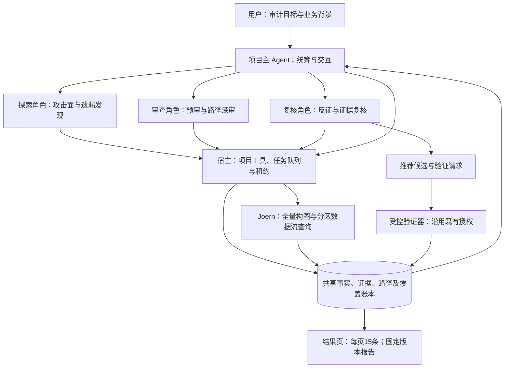

# 图谱审计 Agent 组织方案

日期：2026-10-25；实现进度更新于 2026-10-26。状态：组织与知识写回设计，首个猜想/问题/证据写回切片已实现，其余角色调度与事实投影尚未交付。当前合同见[调查知识](../investigation-knowledge.md)；后续公开测试边界按切片确认。

本方案细化[项目审计与主 Agent 架构](project-agent-architecture.md)，保留 ADR 0001 的开放对话、共享领域服务和宿主调度，以及 ADR 0002 的整体 Joern 引擎。项目主 Agent 的完整项目访问已由 #73 交付；本方案讨论如何利用这些权限开展系统审计。

## 1. 目标与基本判断

用户已明确要求：图谱覆盖整份代码；去除 100 条污点流上限；主 Agent 自主选择 source、sink 并增补路径；默认路径页只展示高概率漏洞候选，每页 15 条，支持翻页。

建议采用“一名项目主 Agent、三类专业工作角色、共享证据与覆盖账本”的结构。Joern 负责可复查的代码事实和静态数据流，Agent 负责攻击面理解、语义审查和反证，宿主负责执行与记录。角色是任务职责，不要求每个角色长期独占一个模型进程。

三个集合分别保存：

1. **代码与攻击面全集**：源码清单、CPG、代码查询索引、入口、source、sink、控制和未解析点。
2. **路径与审计工作全集**：Joern 原始轨迹、Agent 探索提案、待审问题及每条问题的状态。
3. **推荐候选集**：经过预审、具有具体漏洞依据的路径；默认页从这里每次读取 15 条。

页面条数不约束前两个集合，也不充当后台审计队列的上限。数据流存在、优先级高、漏洞已确认是不同事实。

## 2. 组织结构



| 角色 | 主要责任 | 必须留下的产出 |
| --- | --- | --- |
| 项目主 Agent，1 名 | 理解审计目标；读取整个项目；选择任意入口、source、sink、模块和路径；分配工作、调整方向、处理阻塞及汇总 | 公开计划摘要、任务依据、工具记录、未完成范围和面向用户的结论 |
| 探索角色，按需运行 | 建立框架与攻击面地图；检查规则漏识别；从入口向下、从 sink 向上和从业务不变量三个方向发现问题 | 有固定源码依据的 source/sink 分类、定向 Joern 查询请求、路径提案和模型缺口 |
| 审查角色，可并发 | 对候选进行轻量预审；对有价值的路径深入阅读源码、调用者、约束及控制 | 四条审计义务的逐项判断、支持与反对证据、具体漏洞假设或排除理由 |
| 复核角色，独立运行 | 检查初审最可能错误的前提；重新核对控制、可控参数、生产可达性和业务条件 | 接受、退回补证或反驳的理由；剩余未知；需要何种验证 |

覆盖统计、去重、租约、重试、暂停恢复、报告快照由确定性程序完成，不另外安排一个模型凭对话印象记账。验证器是已有领域执行能力，不由 Agent 自行启动任意进程。

起步建议总并发 4：一名主 Agent 加三个工作槽。工作槽可分配为一个探索、两个审查；需要复核时释放一个槽给复核。大项目按预算调整并发，不为每个函数创建 Agent，也不固定为每种漏洞类型常驻一个 Agent。

审查任务可按注入、文件与网络操作、鉴权与业务逻辑等方向选用不同工作指引；其状态、证据格式和工具来源保持一致。主 Agent 可以自己完成小问题，不必强制委派。

分工首先按“入口或业务操作 → 信任边界 → 敏感操作/资产”划分审计单元，覆盖所有模块及共享控制。漏洞类型用来选择审查方法，不把一个文件永久交给一个专家。跨单元调用可以继续读取和追踪；共享鉴权或净化的结论只有在同一版本、调用上下文和前提成立时才复用。

## 3. 权限与工具

主 Agent 继续拥有当前项目内完整读取和已授权操作能力：源码、CPG 查询、所有 source/sink、原始路径、任务、运行、发现、报告和产物；不因当前聊天绑定了某条路径而缩小到该路径。旧项目有多个输入时，主 Agent 可以选择项目内输入，每次操作记录实际输入和图谱版本。

子任务固定其审计输入、目标和预算，但应允许读取同一项目的关联代码，避免只能看到预先裁剪的几行源码。宿主沿用调用者身份和项目校验，跨项目数据不混入证据。

应提供以下领域能力，并由 REST、MCP 和 Agent Runtime 共用实现。下列名称仅描述能力，不表示已注册工具：

| 能力 | 关键输入与行为 |
| --- | --- |
| 攻击面目录 | 按框架、文件、生产/测试属性、入口、source/sink 类型筛选并分页；目录独立于是否已找到流 |
| 代码与调用查询 | 搜索定义和文本、读取固定源码、上下游调用、控制条件、未解析调用与原始 CPG 节点 |
| 数据流检索 | 选择 source、sink、规则、CPG 和版本；查询已保存的全部轨迹，并可申请定向补查 |
| 语义补充 | 提交有源码依据的自定义入口、敏感操作、传播或净化模型；宿主校验后生成版本化配置 |
| 路径提案 | 引用真实端点、边、源码和 Joern 轨迹，提交新问题或关联现有问题；登记类型和未知连接 |
| 审查协调 | 创建或领取工作、读取进度、追加方向消息、暂停、继续、取消及申请受控验证 |
| 证据与覆盖查询 | 区分已分析、未分析、没有找到流、部分完成、被阻塞及已排除的范围 |

Agent 提出新规则或路径后，宿主检查同一输入与图谱版本、节点和引用是否存在、证据类型、请求幂等及实际操作授权。不能直接让模型写数据库、伪造边或修改既有验证裁定。

用户启动项目审计时，可在既有授权和预算内自动探索、增补路径并调度静态审查，不要求每条候选再次人工点击。单纯构图操作继续只执行构图与工具分析；动态验证等领域动作沿用相应授权。

已有真实 Joern 轨迹可以登记为数据流候选；只有调用链的登记为调用可达候选；尚未连接的推断保留为假设。后两者仍可触发探索，不能冒充 Joern 已证明的流。

### 3.1 知识写入的共同边界

在代码结构层之上增加知识断言层。代码结构层保存引擎产生的函数、调用、数据流和路径；知识断言层保存关于这些对象的判断、调查问题和证据关系。不得把函数节点本身改成“漏洞事实”：同一个函数可能涉及多个判断、调用上下文和不同结论。

所有角色均通过领域服务提交结构化提案，不提供绕过校验的通用 `add_node` / `add_edge` 或数据库写入工具。REST、MCP 和 Runtime 使用同一合同。工具名称在本节仅为建议，不代表已经注册。

| 写入类别 | Agent 能力 | 最终发布责任 |
| --- | --- | --- |
| 调查知识 | 提交猜想、待解问题、证据引用、审查意见和带理由的关系 | 宿主检查权限、Scope、引用、预算与运行栅栏后写入 |
| 结构或模型增补 | 提议入口/source/sink 分类、传播/净化模型、定向查询和关联路径 | 先保存提案；领域工具执行并校验后发布实际结果，提案不冒充引擎事实 |
| 正式裁定与完成状态 | 提交验证申请、复核意见、范围完成建议 | 验证服务派生裁定；覆盖服务计算完成状态；发布服务提交版本 |

主 Agent 的项目完整访问不绕过上述领域边界。子角色权限由当前身份、项目授权、工作包能力和运行状态共同限制；角色名称由宿主绑定，不能通过工具参数自报身份获得权限。

### 3.2 节点、状态和关系合同

“猜想”和“事实”是断言在界面上的知识状态，而非互不相干的两份记录。断言身份与每次评估分离：原始猜想保留，后续接受、反驳、修正均追加评估，不原地改写历史内容。断言陈述发生实质变化时创建新断言并以 `supersedes` 关联旧断言。

| 对象 | 内容及约束 |
| --- | --- |
| 断言 Claim | 一条可核验或可反驳的陈述；包含安全目标、适用条件、上下文和目标引用。初始为猜想；可表达漏洞，也可表达有效控制或参数不可控 |
| 证据 Evidence | 复用现有不可变 evidence / artifact；引用固定源码、查询、轨迹或验证结果。模型说明本身不是独立证明 |
| 待解问题 Question | 指向具体缺口、所需证据、依赖断言与建议调查方向；有开放、处理中、已解决、阻塞状态 |
| 评估 Assessment | 记录义务判断、支持/反对/未决证据、接受/反驳/未决/阻塞意见及其来源；验证裁定引用既有验证记录 |
| 模型提案 ModelProposal | 保存自定义语义、分类或桥接建议、源码依据和执行状态；与工具执行后实际产生的结构事实分别记录 |

每个断言至少固定 `project_id`、`snapshot_id`、目标 canonical 引用、结构化陈述种类及参数、适用条件、来源运行、创建时间。`snapshot_id` 按最新 ADR 0002 作为源码内部关联键使用，不恢复新项目多版本审计。图谱相关记录额外固定 CPG、图层/语义/规则版本；尚无图谱的源码判断记录只读源码位置和宿主采集的证据片段，不引入逐文件摘要或源码完整性校验，也不能伪造图谱 pin。业务目标和用户前提可以没有代码位置，但必须有来源、适用范围与依据类型。

每条评估固定其看到的断言版本、证据集合及知识账本版本；包含 `producer`、`run_id`、工具/模型与配置版本、工作包与 generation。身份和运行信息由宿主填入。当前展示状态由宿主按评估投影，不能由 Agent 请求体直接指定 `fact` 或 `confirmed`。

| 关系 | 方向与含义 |
| --- | --- |
| `located_at` | 断言/问题 → 代码节点、调用点或路径；表示范围，不自动证明断言 |
| `supports` / `contradicts` | 证据或有范围的已接受断言 → 断言；必须给出对应命题和理由 |
| `depends_on` | 断言 → 前提断言或待解问题；表示结论依赖的条件 |
| `derived_from` | 新断言/问题 → 既有知识；记录发现血缘，不等同支持证据 |
| `resolves` | 评估 → 待解问题；必须指出补齐的证据与解决结果 |
| `supersedes` | 新断言/评估 → 旧记录；旧记录及历史投影仍可读 |

关系也保存 Scope、版本、来源和理由，宿主验证端点类型及存在性。禁止跨快照直接建立支持关系；跨快照只允许明确的历史血缘引用，必须重核条件后才能形成新快照的判断。`depends_on` 和 `supersedes` 拒绝形成循环；其他引用环不能被当作独立证据链，自引用和相互引用不能提升事实状态。

### 3.3 什么可以称为事实

断言的调查状态为待调查、调查中、已接受、已反驳、暂不可判定或阻塞。界面只有在满足相应证据政策时才将已接受断言展示为“事实”，同时显示事实种类、适用条件和依据：

- **工具观察事实**：例如“指定 Joern 模型与查询返回了轨迹 T”。宿主从成功执行的固定产物登记，只能证明这一观察，不推导攻击者可控或漏洞成立。
- **经核验的代码/控制事实**：例如“此调用点使用参数化 API”，必须有准确源码与上下文、明确核验规则；Agent 的审查意见默认仍是评估。没有可执行的接纳规则时保留待核验，不能因独立复核接受便自动升级。
- **验证确认的漏洞事实**：沿用既有验证服务和证据政策，由宿主派生 CONFIRMED；复现条件、环境和剩余局限随事实展示。

用户提供的业务规则标记为“用户前提”；Agent 推断的业务规则标记为猜想。二者都不能直接显示为代码已经满足的事实。多个模型同意、模型高置信度、多个工具重复告警以及缺少反例都不是事实升级条件。

发现相反证据时追加分歧与重审记录，保留既有验证裁定历史；未经领域裁定不能覆盖正式漏洞状态。已反驳仅指特定命题在特定条件下被反驳，不把整个函数或项目标记为安全。新快照不继承旧快照的事实状态。

### 3.4 角色写入权限矩阵

| 环节/角色 | 可提交的知识 | 必须由宿主或独立能力决定的部分 |
| --- | --- | --- |
| 主 Agent：计划与统筹 | 审计目标、用户前提引用、安全不变量猜想、调查问题、初始漏洞猜想、工作方向 | 不替代用户制造业务规则；不自行认定覆盖完成或验证确认 |
| 探索：地图和缺口 | 分类/模型提案、信任边界猜想、未解析点、开放前沿、路径提案、所需查询 | 推断连接不得成为已观测数据流；分类通过领域校验后才进入版本化配置 |
| 轻量预审 | 具体漏洞猜想、前置条件、证据引用、待补问题、局部排除建议 | 不写已确认漏洞；排除范围由目标和条件约束 |
| 深审与补查 | 义务逐项评估、控制有效性猜想、支持/反对证据、关联问题、新路径/模型提案 | 不以“未看到控制”证明“控制失效”；业务问题使用对应义务而非强套污点流 |
| 独立复核 | 反证、前提修正、分歧、补证问题、接受/退回/反驳意见 | 不能覆盖初审；不能为自己的初审运行签署独立复核；复核通过仍是候选 |
| 受控验证 | Agent 申请验证并引用已有知识；验证器产生执行证据 | 验证领域服务派生正式裁定并投影知识状态 |
| 汇总与报告 | 带引用的知识摘要和未完成范围 | 摘要是派生产物，不能反过来作为其来源断言的独立证据 |

角色表示执行该职责时的能力集合；主 Agent 自行处理小问题时仍遵守对应职责的合同。独立复核按运行来源和工作血缘检查，不以换一段提示词代替独立运行。

### 3.5 建议领域工具与写入流程

建议按领域意图提供 `propose_claim`、`open_question`、`attach_evidence`、`submit_assessment` 和 `propose_semantics`，复用路径提案、受控验证申请以及固定版本查询能力。`attach_evidence` 引用真实 evidence/artifact 或经宿主读取核验的冻结源码；不接受模型自报产物摘要、执行结果或来源身份作为证明。每次工具调用返回记录 ID、账本版本、实际状态及未通过的校验原因，禁止仅返回聊天式“已记住”。

写入依次完成：

1. 认证与项目写权限、角色能力、工作包范围校验；读取授权允许关联代码不代表允许跨工作包提交裁定。
2. 校验固定输入、图谱 pin、端点和证据引用；旧 pin 无法解析时明确返回失效，不换成 latest。
3. 校验结构、命题类型、适用条件、证据关系、预算和单批大小；未知命题允许保留为猜想，不接受未知规则升级为事实。
4. 校验运行仍活动、租约 epoch / generation 有效及取消栅栏。已完成运行的历史记录可读取，但不能追加新的 Agent 写入。
5. 同一事务追加知识记录、CAS 更新投影/账本版本并写 outbox；任一步失败不发布半条关系或调度事件。

逻辑断言身份由固定输入、命题类型及规范参数、目标、条件和相关语义版本形成，标题不参与身份。无法可靠规范化的自由文本命题不按文本相似度自动合并。重复发现增加独立 observation，保留发现者；同一请求键和摘要重放返回原结果，不重复计数，同键异摘要冲突。并发意见分别保存，投影 CAS 冲突后按当前状态重算，不丢弃反对意见。

工具返回真实的权限、pin 失效、引用不存在、版本冲突、租约失效或预算错误；不以本地聊天笔记替代持久化失败。

## 4. 全量图谱与 Joern 分析

### 4.1 代码图谱先独立成立

整份只读源码输入先生成源码清单和所有匹配语言的 CPG，保存文件、方法、调用及可用的数据流事实。解析完成的代码索引不应等待候选预审才能查看。污点查询失败时保留可读取的有效代码图谱，安全语义与路径层明确显示自己的失败或未完成状态；不同图层的版本关系必须可查。

“全量”指全部输入都进入清单、每种受支持语言都按配置处理。未支持文件、解析失败、依赖缺失和动态解析缺口分别记账，不把未处理文件计成解析成功。

### 4.2 source/sink 目录独立生成

先记录所有规则匹配的 source 和 sink，再生成数据流。普通函数参数可以是潜在传播起点，但不能直接标为攻击者可控输入；宽泛名称命中也不能直接标为敏感操作。

目录保存规则命中、canonical 节点、文件位置、框架角色、生产/测试属性和语义确认状态。匹配次数、去重节点数、入口数及产生流的端点数分别统计。未产生流的 source/sink 仍能被 Agent 检索。

### 4.3 去除前 100 条截断，采用可恢复的分析分区

不再按全局 `max_flows=100` 保留前缀，也不以改成另一个总条数替代。以固定 CPG、规则、sink 分区和 source 批次形成查询工作，所有分区进入持久队列；不能让第一条泛化规则占满预算后饿死后续规则与语言。

Joern 返回的原始轨迹分块保存到 ArtifactStore，PostgreSQL 保存端点、轨迹摘要、索引和状态。结果分页、输出分块和每次调度批次大小只是传输与执行方式，不丢弃后续路径。排序阶段只添加排名和推荐标签，不删除原始路径或未入选候选。

每个查询工作记录固定版本、选择器、状态、完整性和恢复位置。若 Joern 查询本身不能从中间位置恢复，应重跑确定的分区并按轨迹身份去重，不能伪称支持引擎内游标。

超时、内存或磁盘不足时保存已经核实的分区结果，未完成分区保留为待续或受阻；不把这一轮称为全部分析完成。

### 4.4 “所有路径”的可验收定义

目标是覆盖固定版本、规则和静态语义下全部识别出的 source/sink 查询范围，保存该范围查询返回的全部不同轨迹，并对未完成查询明确记账。不能承诺源码中所有现实执行轨迹：循环、动态调用、外部依赖和上下文深度都会影响模型。

Joern 的 `reachableBy` 查询可到达的源，`reachableByFlows` 返回数据流路径；这两者都依赖给定模型。[Joern 数据流查询文档](https://docs.joern.io/cpgql/data-flow-steps/)

“没有找到流”只表示某个已完整执行的查询在该模型下没有结果。未知查询、超时、解析缺口和选择器遗漏分别保留，不计成安全。

多个 CPG 之间的跨语言或进程通信需要有依据的桥接模型；没有模型的连接保留为开放前沿，不能由 Agent 拼接成 Joern 已观测的轨迹。

## 5. Agent 如何审计

### 5.1 第一轮：地图和覆盖缺口

主 Agent 先读取语言、框架、入口、source/sink 目录、文件覆盖和未解析点，确认线上入口与测试辅助代码的区别，再提出审计计划。探索角色检查框架封装、调用链断点、宽泛规则误命中和未建模库。

主 Agent 可以从任意 sink 反向寻找输入，也可以从入口向下追踪，不必等系统给出一个固定的候选列表。

### 5.2 第二轮：轻量预审

审查角色从路径账本领取一个问题，按需读取固定源码，先回答：

- 这是生产可达代码吗，攻击者处于什么身份？
- source 中具体哪个值可控，控制范围和前提是什么？
- 该值是否进入 sink 的危险参数，传播是否仅来自过宽的库语义？
- 校验、净化、参数化、鉴权或业务约束是否阻断假设？
- 如果存在问题，会违反哪条安全目标，缺哪项证据？

预审输出待深审、有理由排除或受阻，不直接写成已确认漏洞。相同 root cause 的近似路径可以复用已核实证据，但成员路径、差异和待查控制必须保留。

### 5.3 第三轮：深审与补查

深审沿用已有四条义务：源可控、到达 sink、控制失效、sink 敏感。每项给出满足、不满足或未知，以及固定源码/图谱证据；未知附明确阻塞原因。不能用“没有看到 sanitizer”代替“sanitizer 不有效”。

遇到缺口时可请求定向 Joern 查询、扩大已授权的查询深度、检查调用者、补充有依据的传播模型或提出关联路径。新增路径写入同一账本并保留发现者与工具调用，不仅留在聊天文本。

业务逻辑另设探索方向：围绕资源归属、角色权限、状态转换、租户隔离和关键业务不变量建立问题。越权和状态机错误可能没有传统污点流，不应因缺少 source→sink taint 证据被排除；其证据义务应匹配业务安全目标，并在界面标明证据类型。

### 5.4 第四轮：独立反证

复核角色先检查原始证据，再阅读初审结论，重点找足以推翻问题的条件：常量或不可控参数、仅测试入口、参数化 API、上下文有效的净化、上游鉴权、不可达分支、部署前提及对象归属约束。

同一初审运行不能给自己的结论签复核通过。复核有分歧时回到缺失的事实和证据，不以模型票数决定。独立运行有助于发现错误，但实际收益仍须用标注样本评估。

外部方法没有准确语义时，Joern 可能保守传播到多个参数和返回值，产生额外路径。因此不能把所有 unresolved/external 调用都解释成断链，也不能把穿过它们的流直接视为高置信漏洞。[Joern 自定义数据流语义文档](https://docs.joern.io/dataflow-semantics/)

### 5.5 知识驱动的循环调查

四轮是职责顺序，不是一次性流水线。深审或复核发现缺口后，将其登记为 Question，并记录依赖该问题的断言和具体义务；主 Agent 可以把调查重新交给探索或补查。典型闭环为：

```text
猜想 → 明确前提与缺失证据 → 登记问题
     → 调度探索/定向查询 → 证据与评估写回
     → 解决问题或记录阻塞 → 重审受影响猜想
```

例如“下载接口存在路径穿越”依赖输入可控、路径可达及目录约束失效。深审发现目录约束封装未知时创建问题，探索读取该封装与调用者，追加源码证据；如果约束有效则提交反证，否则补齐失效条件并继续调查。每次转交引用同一问题，不通过改写标题创建重复工作。

新增知识通过 outbox 事件触发依赖索引，确定性调度器仅为受影响的问题或义务登记重审需求，去重键包含工作身份、知识变更和目标评估版本。重复投递不重复领取；正在执行的工作继续使用原固定输入，其结果若依赖旧知识须标记需重审，不冒充已评估新增证据。暂停期间可记录待续需求，但不得自动启动；取消工作不被事件复活，新调查须创建合法后续工作。

整项目是探索范围，每轮只读取有界子图与必要证据。无新证据、重复问题或预算耗尽时记录停止原因和开放前沿，不无限互相派生猜想。排序应保留低覆盖区域额度，不能因已有热门猜想而饿死其他模块。

## 6. “高概率”结果页与每页 15 条

建议把默认页产品含义定为“高置信漏洞候选”，以可审查的证据门槛决定是否进入，先不展示未经校准的概率百分比。

进入默认推荐列表需要：

1. 真实生产入口或有依据的部署入口，攻击者身份与输入控制范围明确。
2. 对敏感操作或业务安全目标的影响有具体证据。
3. 数据流类问题有真实 Joern 轨迹，并核对危险参数；业务逻辑类有对应的调用、控制与不变量证据。
4. 已评估相关防护，存在具体的缺失、失效或绕过依据；关键控制仍未知的保留待审。
5. 独立复核接受其主要前提，剩余验证条件清楚。

“默认推荐”不自动提升为平台的已确认漏洞，确认仍沿用既有验证/裁定规则。impact/severity、证据置信度和审查优先级分开保存。

只有三个静态条件“source 命中、sink 命中、有流”时，只足以进入预审队列。仅测试代码默认不进入推荐列表，但保留在图谱和原始路径中；测试可用作验证证据，不冒充生产可达证明。

正式页面采用：

- 默认视图：高置信候选，每页 15 条；不足 15 条按真实数量显示。
- 审查工作视图：预审中、待深审、受阻及已排除问题，同样支持筛选和分页。
- 原始路径视图：完整已保存轨迹，按 source/sink、规则、CPG 和来源检索。
- 页头分别显示推荐数、待审数、原始轨迹数和覆盖缺口，不能用单一“0”混淆它们。

后台仍处理全部待审范围，并保留低覆盖区域的探索额度，不能永远只审排序最前面的路径。15 不是 Agent 可选择路径数或累计审计数量。

知识图谱增加“代码 / 事实 / 猜想 / 待解问题”筛选，并用文字和形状区分类型，不仅依靠颜色。选择断言展示其适用条件、固定输入、支持/反对证据、依赖问题、各次评估与来源；事实必须显示事实种类，反驳与历史记录可查。展开局部关系有节点/跳数预算与截断说明。知识视图固定代码 pin 与知识账本版本；有更新提示刷新，不静默替换已打开的证据。

路径的证据类型、执行状态和审查结论分别保存：例如一条真实数据流可以处于暂停审查状态，最终也可能被有效控制排除；这不删除原始轨迹或改写它的证据类型。

分页固定路径账本版本和排名版本，使用稳定顺序与游标。审查途中产生新路径或改变推荐状态时提示刷新；不得因实时重排使翻页漏项或重复。

未启动 Agent 审查时显示“尚未预审”，不把原始流套用高概率标签。图谱构建模式继续可以不调用模型；用户启动项目审计后，按已授权的策略和预算运行预审、探索与复核。

## 7. 共享记录、完成判定与恢复

每个工作包至少记录：项目与输入、图谱/语义版本、问题与来源、source/sink 或业务目标、原始轨迹/源码引用、规则摘要、当前义务、父任务、预算、租约和 generation。

工作包只携带必要索引与证据摘要，Agent 可以继续取完整关联源码；不把整份图谱一次塞入提示词。保存公开计划、工具行动、结果和结构化证据，不保存隐藏推理。

路径逻辑身份应基于固定输入、canonical 端点、实际边或轨迹和相关语义配置，而不是标题或随机 UUID。多次发现添加 observation；不同防护分支或不同真实轨迹不能只按同一端点合并。保持现有逻辑路径身份与 audit 内调度身份的区分，避免重复运行造成虚假数量增长。

覆盖至少分三本账：

| 账本 | 完成所需证据 |
| --- | --- |
| 构图覆盖 | 输入清单、语言/文件处理状态、解析错误和未支持范围 |
| 数据流覆盖 | 已识别 source/sink、规则和分区目录；每项已完成、无结果、部分完成或受阻状态 |
| 审查覆盖 | 问题是否预审、深审、复核或排除；未满足义务、开放探索前沿及预算状态 |

有准确分母时才给比例。未发现的入口或未知框架模型不能假装计入一个完整分母。

Agent 结束一轮只表示该轮终止。只有相应覆盖范围内的工作完成，才允许该范围进入审计完成态；存在重要阻塞时展示部分完成和阻塞项。新增 source/sink、语义模型或路径会形成新账本版本及需重审范围，不改写旧合同和固定报告。

PostgreSQL 保存断言、问题、评估、关系、观察、依赖索引及知识变更 outbox，与现有 evidence / findings / verification 通过真实 ID 关联。断言层不复制另一套可写的验证状态；确认状态从验证领域记录投影。报告固定代码 pin、知识账本版本及验证引用，后续评估不改写历史报告。快照删除沿用活动工作栅栏，并按既有删除策略清理本快照的知识与依赖，不能遗留孤立关系。

PostgreSQL 保存任务与覆盖状态，ArtifactStore 保存分块原始结果，沿用现有租约、epoch、CAS、幂等和迟到结果栅栏。重启后继续未完成工作，复用已完成分区和证据；已暂停任务不会被恢复流程擅自启动。

## 8. 与现有实现的衔接

现状核对：`internal/workflow/default.go` 的默认 taint 配置仍为 `max_flows=100`；`cmd/joern-adapter/enhance.go` 主要按路径依据分类打分；`web/src/Knowledge.tsx` 的路径请求仍为每次 50 条。它们都尚未实现本文定义的完整路径目录和高置信候选页。

`cmd/joern-adapter/taint.go` 的安全端点目录从保留流提取，需改为独立目录与完整分区记录。泛化参数规则和宽泛 sink 名称应保留其实际含义，不能直接用作“外部输入”或“敏感操作”确认。

建议沿既有整体引擎及领域服务分批交付：

| 顺序 | 交付切片 | 与现有事项的关系 |
| --- | --- | --- |
| 1 | 全量攻击面目录、去除 100 条前缀截断、分块轨迹与查询覆盖账本；代码图谱可独立读取 | 整体 Joern profile 升级；关联 #50/#51 的查询能力 |
| 2 | 主 Agent 自选 source/sink、定向 Joern 补查、可追溯路径提案；断言/问题/证据关系与 PG 账本、认证 API/MCP、图谱查询和最小页面闭环 | 复用 #73 完整项目访问，补齐 #67 |
| 3 | 探索/审查/复核角色、按职责写入、共享工作包、知识事件驱动的依赖重审与可恢复调度 | 对接 #68/#69；沿用既有路径 Runtime |
| 4 | 证据门槛、独立复核、正式验证裁定投影、事实/猜想与证据历史展示、15 条稳定分页、完整路径检索 | 扩展版本化排序，不把旧评分改义 |
| 5 | 三类覆盖汇总、固定代码与知识版本报告、知识复用与纠错质量评测 | 对接 #47/#48，保留旧运行与报告 |

切片 2 先完成“提出猜想 → 登记问题 → 引用真实证据 → 持久化读回”的最小闭环，不把聊天摘要当作知识库。切片 3 再使问题实际驱动探索和补查；切片 4 接通复核与既有验证服务，未实现的事实接纳规则明确保持待核验。

每个切片应包含相应领域实现、认证 API/MCP、正式页面、PostgreSQL 持久化和验收，避免只更改提示词。升级插件、规则和 profile 使用新版本；旧输入、调用、CPG、路径、报告及历史默认配置保持可读。

## 9. 建议验收场景

以下为待确认的公开测试范围，不表示用户已经批准新增测试边界：

- 真实 Joern 样本产生超过 100 条可区分轨迹，跨多个 CPG 和规则；完整保存，后一分区不因前一分区结果多而饿死。
- source/sink 没有产生流时目录仍存在；宽泛规则匹配次数与真实目录节点数正确区分。
- 已构建代码图谱在污点查询部分失败时仍可读取；解析未支持、查询失败和完整无结果分别呈现。
- Agent 自主选取页面未展示的 source/sink，定向查询并提交路径；真实 MCP、固定输入、引用校验和重复调用去重通过。
- 纯调用链和未证明连接不会变成 Joern 数据流；模型不能自行把候选升级为验证裁定。
- 常量传参、测试辅助函数、参数化 API 和有效净化等反例被合理排除；真实业务越权问题不会因没有 taint 流而消失。
- 对控制仍未知的路径保留待审；没有满足门槛的结果时不填充推荐页，待审数和覆盖缺口可见。
- 31 条合格候选分页为 15、15、1；固定版本无重项或漏项，刷新才进入新排名。
- PostgreSQL 重启、工作租约交接、取消迟到结果、跨项目访问、预算耗尽和新路径导致覆盖版本变化均按真实状态恢复。
- 主 Agent、探索、预审、深审和复核通过同一领域服务提交各自允许的记录；伪造角色、reader 写入和越权裁定均拒绝。
- 猜想绑定真实代码/路径，证据与关系可读回；不存在的引用、跨项目/跨快照支持关系、循环依赖、模型伪造工具事实与摘要自证均拒绝。
- 相同猜想重复发现保留来源且不重复计数；条件不同的命题不误合并，同键异摘要冲突，并发反对意见不丢失。
- 真实静态轨迹只形成工具观察事实；独立复核通过仍为候选；漏洞事实只能由满足既有验证政策的裁定产生，无证据和未知政策不升级。
- 深审提出控制问题，探索补证后触发依赖重审，复核可以追加反证；当前状态和历史版本同时可查。
- 重复 outbox、重启恢复、暂停、取消、租约交接和迟到提交不会重复调度或污染当前知识；取消后事件不能复活旧工作。
- 知识页面按类型查询，证据冲突、条件、未决问题及失效 pin 清楚可见；历史报告在新增知识与重建后保持固定，新快照不自动继承事实。
- 用人工标注的有漏洞/安全样本评估推荐精确率、漏报、复核纠错率、未决比例和成本；增加知识复用后的重复调查率、错误事实接纳数和问题闭环率，不把启发式分数当作校准概率。

2026-10-26 实现进度：已接通首个调查知识切片，包含猜想、问题、证据引用、PostgreSQL 账本、认证 API/私有 MCP 和图谱页查询，具体合同与局限见[调查知识](../investigation-knowledge.md)。角色调度、依赖重审及事实投影仍为后续设计；本切片没有修改路径数量限制。

同日另已接通 #51 的只读攻击面目录（入口 / sink、节点证据、2 KB 仓库地图），并开始 #79：`codexploit.joern@2.3.0` 随包固定 `java-sink-catalog@1.0.0`，先保留全部精确 Java sink 命中（含零流节点），再用严格的 80/20 高风险 / 回退流预算执行数据流；路径带目录 priority hint，`joern.static-support/v2` 只调整审查顺序。真实封存 Joern 已验 JNDI、XXE、SQL 流、零流反序列化 sink 和 enhancement 排序。持久分区账本、完整 20% 页面探索入口、MyBatis / Hibernate 包装模型及 Java 质量评测仍未完成，因此 #79 尚未交付关闭。
