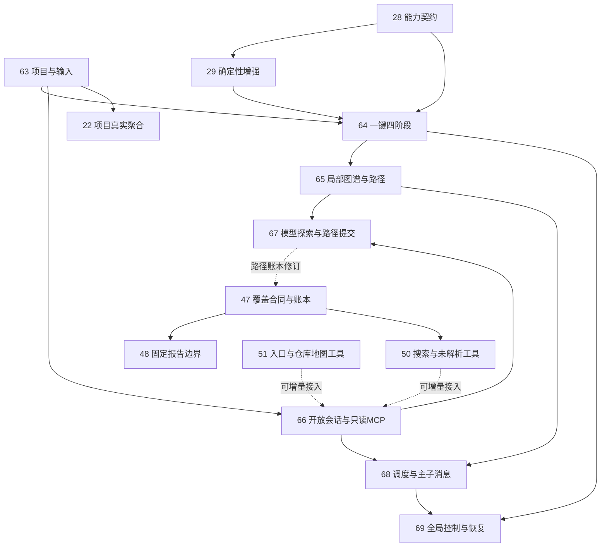

# 当前原型实施 Issues 索引

日期：2026-10-21。状态：产品决策已确认，GitHub 开发方案已同步。**#63、#28、#29、#64、#65、#66 已实现并关闭；#67–#69 仍待开发。** 其余 Issue 正文保持实施规格，不代表已交付。

依据：[目标架构](project-agent-architecture.md)、[ADR](../adr/0001-project-supervisor-interaction.md)、[当前原型](audit-interaction-prototype.md)。开发接手：[deepseek-handoff.md](deepseek-handoff.md)。新Issue完整正文镜像位于 `interaction-issues/UX01.md` 至 `UX07.md`；18个旧单修订镜像在 `interaction-issues/revised/`，实际编号映射见JSON manifest。

## 新增端到端切片

| 顺序/草案 | GitHub Issue | 类型 | 新增阻塞 |
|---|---|---|---|
| UX01 | [#63 项目创建隐含保存单份源码并接通项目管理与删除](https://github.com/UserB1ank/Cod3xplo1t/issues/63) | AFK | 无 |
| UX02 | [#64 从项目一键执行并恢复四阶段图谱化分析](https://github.com/UserB1ank/Cod3xplo1t/issues/64) | AFK | #63、#28、#29 |
| UX03 | [#65 正式页面按入口探索局部图谱并选择有来源的审查路径](https://github.com/UserB1ank/Cod3xplo1t/issues/65) | AFK | #64 |
| UX04 | [#66 主 Agent 通过开放对话与项目作用域只读 MCP 查询真实项目](https://github.com/UserB1ank/Cod3xplo1t/issues/66) | AFK | #63 |
| UX05 | [#67 主 Agent 自主探索并通过 MCP 提交可追溯的新审查路径](https://github.com/UserB1ank/Cod3xplo1t/issues/67) | AFK | #65、#66 |
| UX06 | [#68 主 Agent 通过 MCP 调度子 Agent 并传递开放对话与纠正要求](https://github.com/UserB1ank/Cod3xplo1t/issues/68) | AFK | #65、#66 |
| UX07 | [#69 项目级暂停停止与主子 Agent 重启恢复形成一致生命周期](https://github.com/UserB1ank/Cod3xplo1t/issues/69) | AFK | #64、#68 |

每个切片包含必要的契约/应用服务/认证API或MCP/正式UI/PG持久化/文档和验收，不是只交一层代码。AFK不免除已规定的测试边界确认或真实模型验收；提交/关闭按AGENTS.md既有授权，push等待明确要求。

## 依赖图

虚线是数据契约接入/增强，不是新增硬阻塞；#47可先用既有路径交付，不等待#67；#66也不等待#50/#51。所有基础runtime与存储前置以已关闭Issue/现有代码复用，不重开。

## 已修订的18个开放 Issue

| Issue | 本次变化 |
|---|---|
| #19 | 输入/产物/证据引用适配新项目与主子任务；外部产物后端不是首轮主线阻塞 |
| #20 | PostgreSQL一致性备份恢复为主，SQLite仅旧源单向迁移；纳入会话/指令/账本 |
| #21 | 主Agent不扩大受控Worker既有授权；保留评论里的本机fixture边界 |
| #22 | 真实项目总览/搜索，分别统计四阶段、主Agent、子任务、候选/确认、报告 |
| #27 | 真实示例对齐新项目/阶段，不调模型、不复制原型；协调已有WIP |
| #28 | 默认四阶段能力真实核验，插件/Runtime/MCP目录职责分离 |
| #29 | 第四阶段确定性筛选评分，同时保留高级自定义工作流入口 |
| #30–#36 | 验证/环境/报告由主子任务来源链接，原审批/隔离不放宽，不阻塞静态主线 |
| #47 | 不可变合同 + 路径集合/账本修订，新增路径不能继承旧范围完成状态 |
| #48 | 固定覆盖/发现/主子来源，后续路径/消息不改旧报告 |
| #50/#51 | 查询领域实现与MCP/两类Agent共用，禁止另建TS后端或用户指令类型 |

已完成的#1–#18、#23–#26、#37–#46、#49、#52–#62不改写交付历史；#26旧导航入口兼容，新主导航由当前原型定义。旧#56–#62 Pi计划索引已标为历史已交付，不能据旧排期重做。

## 独立后续路线

- #19 → #20：外部产物与完整备份恢复/旧库迁移。
- #19 → #21，#28 → #30，#21+#30 → #31 → #32 → #33/#34 → #35/#36：隔离验证路线，保留真实依赖和人工授权。
- #27：既有启动示例WIP，按新输入/阶段状态验收，开发前协调文件所有权。

## 实施进展

- 2026-10-21 — #63：单源码项目创建隐含保存输入与快照，input `importing -> ready/failed`，
  名称/说明 CAS 编辑，真实目录/概览，writer 可恢复删除（tombstone、snapshot 栅栏、
  活动引用校验、迟到写入拒绝）。Memory/SQLite 测试双与真实 PostgreSQL 均验收；
  旧多来源项目保留兼容。
- 2026-10-21 — #28：九个能力阶段接入版本化领域协议（Agent / 环境供应 / 验证 /
  路径增强），本地 Schema 注册且未知类型离线拒绝；插件记录固定协议版本，
  清单声明的协议与宿主不一致时不可执行；能力目录区分插件 Runtime、Agent Runtime、
  环境后端、验证执行器与原生服务，展示声明/安装/实测状态和真实原因；插件页
  消费同一 API；工作流编译要求插件产出其声明能力的契约，并在运行前拒绝未知、
  不兼容或歧义输入。旧记录/计划/产物保持可读。

## 同步范围

新增#63–#69已发布并加`needs-triage`；18个开放Issue正文已更新并逐项回读核对。未更改已关闭Issue、评论、现有动态执行授权或Issue状态。仓库文档/原型修改仍在本地，尚未commit/push；GitHub正文已自包含核心实施要求。
