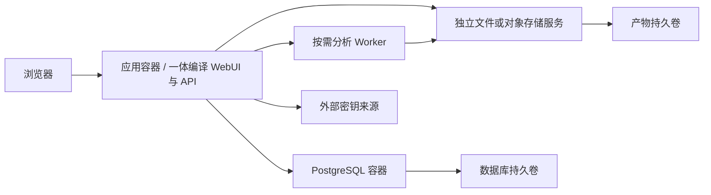

# L9 持久化接口与独立 Docker 数据服务

目标：数据库与产物由独立 Docker 数据服务承载，应用通过领域存储接口访问。推荐 PostgreSQL 作为首个外部数据库适配器；SQLite 保留轻量开发用途，其他数据库通过契约验收后接入。

Schema：[storage.schema.json](../../../../contracts/v1/storage.schema.json)。示例：[storage.json](../../../../contracts/v1/examples/storage.json)。原型可选择后端、校验字段并导出配置；它不创建真实连接。

## 目标部署拓扑

数据库在内部容器网络提供服务，应用的数据库 host 为服务名，例如 `postgres`，不是应用容器的 localhost。应用容器的可写层只放缓存；产物、账号、配置与任务状态必须可从数据服务恢复。

## 数据归属

| 位置 | 保存内容 |
|---|---|
| PostgreSQL / MetadataStore | 项目、代码源定义、快照元数据、产物索引、图谱节点/边/观察/版本、工作流与执行状态、事件、发现、证据索引、幂等记录、账号摘要、会话、加密配置 |
| ArtifactStore | 源码树、文件清单、原生 AST、完整工具报告、证据正文、导出报告 |
| 外部密钥来源 | LLM / 仓库 / 数据库凭据，或解密上述凭据所需的安装密钥 |
| 应用/Worker 缓存 | 可重建源码工作目录、解析缓存、临时结果 |

JSON 属性可以由数据库适配器映射到其原生 JSON 类型；公共接口不要求消费者知道 JSONB 或某个 SQL 方言。可查询的标识、作用域、边端点、状态与版本使用结构化列和索引，不只存一个不可查询的大 JSON 文档。

## 端口与事务

存储接口按领域拆分：ProjectSourceRepository、SnapshotCatalog、GraphRepository、WorkflowRunRepository、FindingRepository、EventRepository、IdentityRepository、SettingsRepository。业务不依赖一个包含所有方法的万能 Store。

| 接口方法 | 请求 | 返回 | 必须满足 |
|---|---|---|---|
| `StorageAdapter.Capabilities` | 适配器配置引用 | 事务、CAS、唯一约束、租约、迁移能力 | 不满足必需能力时拒绝启动 |
| `Health` | 有界 context | ready 与安全诊断 | 不返回 DSN / password |
| `UnitOfWork.WithinTransaction` | 领域回调和隔离需求 | 原子提交 / 类型化错误 | 回滚不暴露半成品视图 |
| `PutImmutable` | 作用域、ID、摘要、内容索引 | 原记录或新记录 | 同摘要幂等，不同摘要 conflict |
| `CompareAndSwap` | ID、expected_version、更新 | 新记录 | 版本检查与更新原子执行 |
| `Claim / Renew / Complete` | work_id、owner、TTL / fencing_token | 租约与新版本 | TTL 由服务端时钟计算；过期或旧令牌写入失败 |
| `AppendEvents` | run_id、expected_seq、events | 连续序号 | 同事务更新状态与事件 |
| `Migrate` | 目标 schema_version、独占迁移锁 | 迁移记录 | 多实例只允许一个迁移者 |

多实例共享会话与撤销状态；LLM 设置和账号不能依赖应用私有文件。加密配置的密文可保存在数据库，解密密钥来自独立稳定密钥来源；仅备份密文不足以恢复。

## PostgreSQL 参考实现要求

- 对 Scope 建复合归属约束，验证快照确属指定项目和代码源；边端点与引用也必须同范围。
- 更新使用版本 CAS；任务 claim 使用事务与行级并发控制。`SKIP LOCKED` 仅用于工作队列领取，不用于完整业务查询。参考官方 [SELECT 锁定子句](https://www.postgresql.org/docs/18/sql-select.html)。
- 以唯一键约束 batch_id、幂等键、run_id + seq、固定插件版本和内容身份。参考 [PostgreSQL constraints](https://www.postgresql.org/docs/18/ddl-constraints.html)。
- 隔离级别由事务语义决定；涉及多行不变量时使用适当锁或可串行化事务，处理序列化失败并重试整个事务。参考 [transaction isolation](https://www.postgresql.org/docs/18/transaction-iso.html)。
- 将视图发布、状态更新、事件/outbox 和幂等结果放在同一事务，不能靠应用内 mutex 代替跨实例协调。
- 配置连接池、查询超时和 readiness。数据服务不可用时停止领取新任务，保留状态以供恢复。

## 图数据库、对象存储与消息队列

第一版在 PostgreSQL 中存图谱索引，通过 KnowledgeReader 提供有界查询。后续专用图数据库可以作为投影或 GraphRepository 适配器。

采用投影时，MetadataStore 的事务 outbox 是发布来源；投影处理幂等、有序，并仅在所需 revision 完整时对外声明就绪。不能在一次请求里向两个数据库直接双写后声称原子提交。

Redis 可作为缓存或通知加速器，任务权属和恢复信息的权威来源仍是事务型存储。第一版不要求额外消息队列。

## 备份、升级与其他数据库

备份包括数据库一致性快照、该版本引用的产物以及解密密钥的独立安全备份。恢复后核对产物存在性和摘要，缺失内容不能以“任务已成功”掩盖。应用升级和数据库升级分开执行；迁移采用可恢复的版本流程，数据库主版本升级通过专门验证。

切换 SQLite → PostgreSQL 需要停写导出、ID/时间/JSON/空值校验、导入、计数与摘要比对、恢复测试和明确切换点；不在两端自动双写。保留原数据备份便于回退。

新增数据库须证明：唯一约束、事务回滚、版本 CAS、双 worker claim、栅栏拒绝、连续事件、图批次发布、幂等重放、分页稳定性、迁移互斥和崩溃恢复。适配器不能依赖 PostgreSQL 特有 SQL 才满足公共端口。

## 当前实现边界

当前默认部署仍是 SQLite + `/data` 数据卷；PostgreSQL 执行模式已接通业务状态、账号、可撤销会话和加密模型设置。账号摘要、会话、登录限流窗口和设置密文由 `IdentityRepository` / `SettingsRepository` 的 SQL 适配器保存，安装密钥由独立部署密钥文件提供。产物内容仍在工作区，独立产物服务属于后续实现。

SQLite 与 Memory 保留原有工作区账号文件和会话实现，不改变默认部署的数据位置。SQLite → PostgreSQL 的数据迁移、备份与恢复演练仍属于后续实施步骤。
