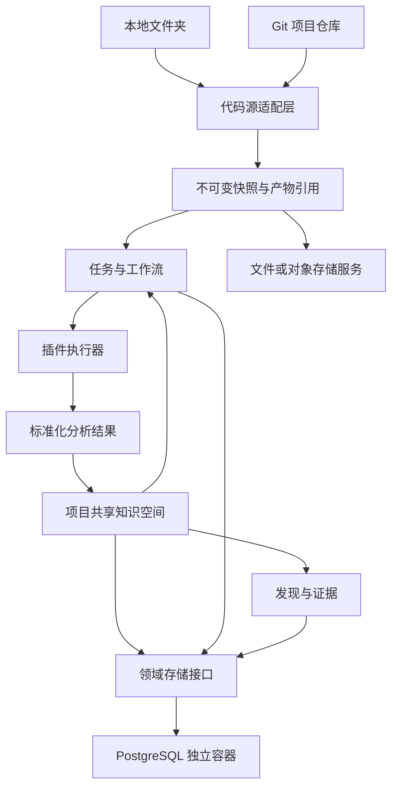

# 分层接口与扩展方案 v1

状态：**设计基线与交互原型**。本目录定义后续实现需要遵守的接口；不代表所有接口已在正式 API 接线。协议标识为 `codexploit/v1`，文档修订为 `1.0.0-draft.1`。

产品保持 **项目 → 任务**。项目管理代码源、快照与共享知识空间；任务固定某个快照、工作流和插件版本。只覆盖漏洞挖掘与证据管理，严重性为高、中、低。

## 阅读顺序

| 层 | 文档 | 边界 |
|---|---|---|
| L0 | [公共约定](00-common.md) | 作用域、版本、错误、幂等、覆盖范围 |
| L1 | [代码源](01-sources.md) | 本地文件夹 / Git 仓库，固定输入 |
| L2 | [快照与产物](02-snapshots-artifacts.md) | 不可变源码与内容寻址产物 |
| L3 | [分析与归一化](03-analysis.md) | AST、工具报告、标准事实 |
| L4 | [知识图谱](04-knowledge.md) | SCG / ASG / 路径 / 证据的统一读写 |
| L5 | [插件](05-plugins.md) | 清单、能力、执行协议、权限 |
| L6 | [工作流](06-workflows.md) | DAG 编译、版本固定、取消与恢复 |
| L7 | [发现与证据](07-findings.md) | 分级、确认、去重、证据与报告 |
| L8 | [应用服务与用户功能](08-application.md) | ARTEX 参考下的导航与用户操作 |
| L9 | [持久化与 Docker](09-persistence.md) | PostgreSQL 独立容器及其他存储适配器 |
| 接线 | [兼容性与实施步骤](10-adoption.md) | 现有代码映射、差距、验收条件 |

机器可读的契约位于 [contracts/v1](../../../../contracts/v1/README.md)，包含分层定义、已接线的运行时 Schema 与完整示例；样例映射以 `contracts/v1/examples.json` 为准。原型的“接口规范”页面可查看并导出同一套 Schema。

## 数据流

代码结构、安全语义、分析路径和发现保留独立类型。原生 AST 和原始扫描报告作为产物保存，通用事实进入图谱索引。每个事实能追溯到源码版本、插件、参数摘要、任务和证据。

## 可操作原型

构建后访问 `/prototype/#tasks`。原型不请求正式业务 API，示例数据在当前页面内存中保存，刷新重置。

可验证：新建项目、添加两类代码源、生成模拟快照、创建任务、分类与并发设置、暂停/继续/置顶/归档、单步节点执行、图谱节点与版本查看、发现分级、插件清单导入、工作流依赖编辑和校验、产物与报告导出、存储方案导出。

“数据库配置校验”只检查配置结构。“单步执行”只推进模拟状态。正式账号登录和模型设置继续使用现有工作区；原型不迁移数据库或执行外部工具。

## 扩展原则

1. 添加语言通过 Parser，添加扫描器通过 Analyzer，添加报告格式通过 Reporter。
2. 工具返回原始产物，Normalizer 转换公共语义；插件不直接写数据库。
3. 工作流只依赖类型化产物与明确的图谱视图。
4. 新数据库实现同样的事务、CAS、事件、租约与恢复契约。
5. 新版本通过契约样例、负面用例和真实适配器验收后才宣告可用。
