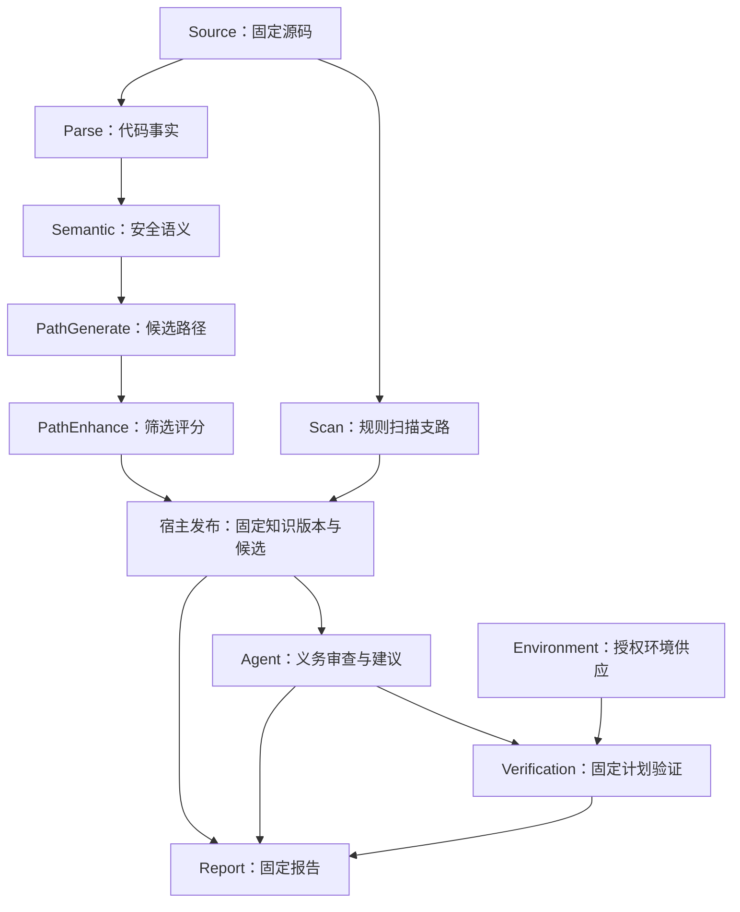

# 分阶段黑盒插件接口方案

日期：2026-10-22。状态：接口设计已用于 v2 重写；实现边界、命令和限制以 [运行与开发手册](../../plugins-v2.md) 为准。Joern Go 转换器与打包流程见 [Joern 手册](../../joern.md)，二进制归档在打包时按摘要下载。

## 1. 参考 ScopeSentry 的结论

参考用户提供的模块流程图，并核对以下源码快照。只借鉴设计，不复制第三方实现：

| 来源 | 核实内容 |
|---|---|
| [ScopeSentry 管理模型](https://github.com/Autumn-27/ScopeSentry/blob/d770b7a137ec2de15816fea4bd561f49cf486db2/internal/models/plugin.go) | Module、Version、Hash、参数和状态分别登记；节点有安装与检查状态 |
| [扫描端插件接口](https://github.com/Autumn-27/ScopeSentry-Scan/blob/cf9a46e176f0bcba6c7000bcad8b0b72b872dc63/internal/interfaces/plugin.go) | 同一 Plugin 接口包含 Execute、Install、Check、UnInstall、Clone 等生命周期行为 |
| [模块接口](https://github.com/Autumn-27/ScopeSentry-Scan/blob/cf9a46e176f0bcba6c7000bcad8b0b72b872dc63/internal/interfaces/module.go) 与 [端口扫描模块](https://github.com/Autumn-27/ScopeSentry-Scan/blob/cf9a46e176f0bcba6c7000bcad8b0b72b872dc63/modules/portscan/module.go) | 模块编排插件、接收类型化结果、去重并传给下游；不适用的输入存在透传分支 |
| [自定义插件加载](https://github.com/Autumn-27/ScopeSentry-Scan/blob/cf9a46e176f0bcba6c7000bcad8b0b72b872dc63/internal/plugins/custom.go) | 自定义 Go 源码经 Yaegi 加载；这是一种实现选项，不是本方案对第三方工具的要求 |
| [Findomain 模板](https://github.com/Autumn-27/ScopeSentry-Plugin-Template/blob/294e23ca9dc9579db3c828643eb7a1846a6d9c37/plugin/SubdomainScan/Findomain/plugin.go) | 适配代码管理外部程序，调用二进制并把结果转换为模块结果类型 |

借鉴的是“模块固定职责、模块内工具可替换、输出按类型衔接、安装检查单独管理”。本项目仍使用固定快照、不可变产物和显式 DAG；不照搬扫描业务模块、Go 进程内解释器、数据库直写或隐式跳过。

ScopeSentry 的 `Hash` 字段不能直接当成本项目的文件完整性证明。本方案分别登记逻辑 ID、版本及 SHA-256，不把名称、随机标识或版本字符串当摘要。

## 2. 设计原则与边界

1. 宿主只依赖阶段、输入输出契约和调用协议，不依赖工具的内部语言、算法、中间步骤或图数据库。
2. 工具可以是完整二进制、包含启动脚本/JAR/动态库的发行包，或自行实现协议的程序；不要求提供源码，也不要求链接项目 Go 包。
3. 适配器负责把标准输入交给工具，并把原始结果转换为标准输出。转换器的版本、规则和摘要属于执行身份；内部算法无需向宿主披露。
4. 同一工具包可提供多个 operation，每个 operation 只绑定一个阶段及一组明确端口。工作流节点必须选 operation；Joern 可分别提供 parse、semantic、path.generate，不能因一个 CPG 就宣称全部阶段完成。
5. 完整性、退出状态、超时、取消、资源和权限属于调用边界；不审查工具内部实现，但仍必须验证边界。
6. 观察、模型判断、验证证据、最终裁定分开。插件不直接写宿主数据库、知识 head 或 confirmed finding。



这是允许的概念依赖，具体节点和边由固定工作流计划决定。Agent、环境、验证和报告并非每次默认四阶段都会执行。

## 3. 阶段标准

能力 `capability` 保持现有九类；阶段 `stage` 细分路径生成与增强，共十个。扫描为并行支路，环境供应为验证依赖，不把所有阶段强制排成单链。机器可读目录和逐阶段清单见 [stages.json](templates/stages.json) 与 [manifests](templates/manifests/)。

| 阶段 / capability | 必需输入 → 必需输出 | 标准数据与验收语义 |
|---|---|---|
| `source` / source | `source.request` → `source.snapshot` | 输入为已授权 source 定义引用和排除策略；输出固定文件内容、相对路径清单、摘要、排除记录。凭据只由宿主注入引用，不进产物 |
| `parse` / parse | `source.snapshot` → `code.facts` | 文件/符号/调用事实、位置、语言、解析状态、未解析数；AST 和工具原生图可作附加产物。无解析能力的语言返回 UNSUPPORTED |
| `semantic` / semantic | `source.snapshot` + `code.facts` → `security.facts` | 入口、敏感操作、安全控制、关系及证据；每条标 observed/inferred，引用固定代码事实；不把调用关系标为污点传播 |
| `scan` / scan | `source.snapshot` → `scanner.alerts` | 规则 ID/版本、位置、消息、证据、建议分级；无命中与未覆盖区分。规范化可产生 security.facts，但告警不是确认漏洞 |
| `path.generate` / path | `code.facts` + `security.facts` → `discovery.paths` | 路径 ID、有序步骤、入口/sink 引用、依据、完整度、未解析边、局限；call_reachability/data_flow/hypothesis 分开 |
| `path.enhance` / path | `discovery.paths` → `discovery.paths` + `path.enhancement` | 只选择、排序已有路径；保留原 ID，输出评分/筛选原因及算法版本；保留集与过滤集覆盖输入集合，不创造调用边 |
| `agent` / agent | `agent.task` → `agent.answer` | 固定义务清单、路径、知识 pin、证据引用；逐义务结论、blocker、反证与建议。使用现有 Agent runtime 领域端口 |
| `environment` / environment | `environment.request` → `environment.receipt` | 固定环境规格、授权引用、镜像/组件摘要；实际环境、租约、应用的网络策略和销毁句柄。通过环境 provider 领域端口 |
| `verification` / verification | `verification.plan` + `environment.receipt` → `verification.evidence` | 计划/授权/环境匹配；断言、观察、执行结果、日志引用、清理结果；基础设施失败不能成为 not_vulnerable 裁定 |
| `report` / report | `report.input` → `report.document` | 输入冻结发现、观察、分级审计、证据、路径和知识版本；输出格式/摘要及覆盖说明；不得重新分析并改变已保存裁定 |

阶段 Schema 已进入生产契约；v2 模板通过 `/api/v2/plugins` 登记，v1 写入口仍只接受旧清单。领域阶段继续使用其授权服务。

### 3.1 共同数据规则

- 每个标准 JSON 产物都包含 `api_version`、`kind`、`schema_id`、`scope`、`producer`、`inputs`、`coverage`、`limitations`、`data`。二进制原生输出使用产物描述符承载这些信息。
- `scope` 固定 project/source/snapshot；producer 绑定插件 ID、插件版本、operation、发行包摘要、invocation、配置摘要、转换器摘要。宿主生成和复核权威字段，不信任工具自报。
- 数据位置使用快照内 POSIX 相对路径，行列从 1 开始、结束位置为开区间；明确未知位置，不虚构第 1 行。不得泄露工作目录绝对路径。
- 标准 code symbol ID 由宿主根据固定 Schema 的语言/路径/限定名/签名/位置生成；已有 Go canonical ID 继续沿用。Joern node ID 只在其原生图内有效，转换器保留映射表和未映射数。
- `coverage` 记录 `unit`、`seen`、`analyzed`、`skipped`、`failed`、`truncated` 和原因。计数单位必须相同，seen=analyzed+skipped+failed；未知数量用 null，不写 0。PARTIAL 必须报告缺口。
- 标准图只引用同 Scope、同 pin 的有效端点；工具扩展数据放命名空间 extension 或原生产物，不向关闭额外字段的 Schema 注入任意字段。
- 包、规则、模型、转换器的版本分别记录。统计不同工具观察不等于确认数量；宿主保留多来源与冲突属性。

### 3.2 数据流与模块调度

沿用 ScopeSentry“模块拥有数据路由”的思路，使用显式规则：

1. 编译器匹配 operation 端口的 kind、schema_id、cardinality、Scope 和知识 pin；不检查插件内部步骤。
2. 不按工具名称或特定上游插件 ID 连接；两个兼容 producer 都存在时，要求 node+port 绑定，歧义直接拒绝。
3. 同一阶段可选多个工具并行运行；聚合行为必须指定 `observations`（保留独立来源）或 `select_one`。不对任意 JSON 数组做无条件拼接。
4. 跨类型转换由有版本、有输入输出的 normalizer operation 实现，不能隐式把 native CPG 当 code.facts，也不能仅修改 kind。
5. 跳过仅在显式 passthrough 端口的 kind/schema 完全相同时允许；parse/semantic/verification 没有兼容输出时必须 SKIPPED/UNSUPPORTED 并阻断必要下游，不能传原输入冒充成功。
6. 批量产物原子发布后再供下游消费。进度事件可以流式传输，但不将半份图作为完成产物。未来增量图必须另设分片提交协议。
7. 路径增强仅选一个权威路径出口；`$publish`/`$analyze` 使用固定出口，不能把已过滤路径从上游重新加回。

## 4. 登记模型与完整性

分开维护五类记录：

| 记录 | 主键 / 主要内容 |
|---|---|
| PluginDefinition | plugin_id+plugin_version；名称、operation、层级、端口、配置 Schema、工具与转换器元数据，不可变 |
| PluginRelease | definition+OS+arch+package_digest；清单摘要、全部普通文件摘要、入口摘要、依赖锁、工具发行版本与许可证标识，不可变 |
| PluginInstallation | release+worker_id；部署位置由宿主内部保存、安装/核验/探测状态、原因、检查时间；不改定义 |
| PluginPolicy | 启用/禁用、安装授权、允许阶段/权限、可选默认版本、CAS version、审计；禁止改写历史运行 |
| PluginInvocation | 固定 release/operation/输入/配置/知识 pin/租约，运行状态与产物；历史保留 |

多平台文件允许同一插件逻辑版本拥有不同 release；同一平台/同一版本不能偷换包。重复同摘要幂等；同键不同摘要返回冲突。默认版本只影响新编译计划，旧计划不追踪 latest。

打包使用 `manifest.json` + `files.lock.json` + 普通文件。清单不得包含本机路径、用户名、秘密或任意 shell 安装命令。模板里的依赖包由部署者放入，平台探测与健康检查必须真实执行。

规范摘要算法 `codexploit/plugin-release/v2`：

1. files.lock 的 payload 清单不包含 manifest.json 和 files.lock.json，避免自引用；包括 adapter、工具、查询脚本、规则、normalizer、动态库和打包的 JVM。
2. 每项为 `{path, bytes, sha256, executable}`，路径规范且唯一，按 UTF-8 路径字节排序；禁止链接、特殊文件、重复/大小写冲突、绝对或逃逸路径。可执行位参与身份。
3. manifest 与 files.lock 使用 RFC 8785 JCS 规范化；`manifest_digest=SHA256(JCS(manifest))`，`files_digest=SHA256(JCS(files.lock))`。
4. `package_digest=SHA256(UTF8("codexploit/plugin-release/v2\n"+manifest_digest+"\n"+files_digest+"\n"))`，三个摘要均为小写 hex，无 sha256: 前缀。
5. 可信安装登记保存 expected package_digest；从同一个被改写目录重算摘要不能代替比对可信 expected。签名/发行者信任另记，SHA-256 只证明内容一致。
6. 安装、检查、执行前校验全部包内容。运行使用核验后不可变目录/worker 快照；若后端无法抵御核验到启动间替换，不能宣称已消除 TOCTOU，应拒绝其强完整性策略。
7. 外部 JVM/解释器/动态库以固定 dependency release digest 绑定；运行时探测并记录实际版本。只 hash 启动脚本不足以证明工具完整性。

当前 v1 编译型内置包允许宿主重编译后更新摘要，这与目标不可变 release 有差异。迁移必须生成独立宿主 build release，保留原执行身份，不能把旧调用摘要重写为新包。

## 5. 统一生命周期与二进制调用

借鉴 Install/Check/Execute/Uninstall 的开发体验，但安装归可信包管理器；第三方程序不获得任意安装脚本执行权。

| 操作 | 宿主职责 | 适配器职责 |
|---|---|---|
| Register | 校验定义/层级/端口、保存不可变元数据 | 提供清单 |
| Install | 校验 release、平台/依赖、安全落盘和节点记录 | 提供静态文件与依赖描述 |
| Check | 校验包、执行限额探测；区分存在、握手、真实契约样例通过 | 回报版本/协议/支持 operation；探测不运行目标代码 |
| Execute | 固定输入、配置、权限与预算，分配隔离工作目录 | 内部自由调用工具；转换并返回约定产物 |
| Cancel | 停止进程树/作业，撤销租约，拒绝迟到提交 | 配合停止及资源清理 |
| Uninstall | 禁止新调用；活动引用冲突，历史版本记录保留 | 不直接删除共享文件 |

状态分轴记录：registered、installed、integrity（unknown/verified/failed）、probe（not_run/passed/failed）、enabled、executable、reason、checked_at、worker_id。握手通过不等于功能实测，文件存在不等于可执行。

### 5.1 两种接入档位

**原生协议程序**：目标 `codexploit/process-plugin/v2`，UTF-8 NDJSON JSON-RPC，initialize/execute/status/cancel、事件及产物读写通道；operation 和多输出替代 v1 的 scanner-only capabilities、单报告假设。不能直接把新消息发给旧扫描器。

**CLI 二进制程序**：由薄适配器包装，可以选择 NDJSON adapter 内部使用 file-job，或选择已实现的 file-job driver 直接调用适配器。直接调用时必须登记 `runtime.protocol=codexploit/file-job/v1`，不能登记成 NDJSON 协议；当前宿主已实现两种驱动。Joern 等现成工具无需实现 JSON-RPC。

```text
工作流节点 → 阶段端口 → 通用执行驱动 → adapter → 固定工具发行包
                                                  ↓
宿主验证/原子发布 ← 标准产物 + 原生产物 ← normalizer
```

file-job 命令固定为 `adapter --request <job.json> --response <result.json>`；argv 按数组传递，禁止拼 shell。一个进程只处理一个 invocation。请求包含已核验输入挂载、输出目录和预算，结果只声明输出目录内的相对普通文件；宿主重算摘要、做 Schema/引用校验，生成正式 ArtifactRef。不能让程序自授任意 artifact ID、绝对存储路径或租约。

进程退出码为 0 且 result 状态成功才进入验证；非零/超时/取消/无结果/非法输出都不能被同名旧 result 覆盖。输出文件先写临时文件再 rename；新调用工作目录必须为空且独占。

Agent、environment、verification 仍通过各自领域端口调用；它们可以共用 release/安装/完整性登记，但不能被一个普通 plugin.execute 请求绕过原来的模型预算、审批或环境授权。

### 5.2 消息及输出生命周期

控制消息默认 ≤1 MiB，产物分块 ≤256 KiB；总输入/输出/文件数/单文件/时长由宿主按 operation 预算配置，不把 Joern CPG 强塞进现有 16 MiB scanner 报告上限。安装包大小/文件数也由独立 release 策略限制；当前 128 MiB/1000 文件的 process 包限制不能直接假设适合完整 Joern/JVM 发行包。提高上限必须显式配置并有界流式核验，不能取消预算。超限返回 budget_exceeded。

NDJSON v2 产物通道需提供 begin/write/finish/abort，每个暂存对象绑定 invocation+output_port，连续序号、长度/摘要核验；finish 只封存暂存对象，所有必需输出和标准引用验收通过后才一次提交调用终态与产物引用。任何失败不发布半批标准结果。

事件 seq 从 1 开始，当前实现最多接收 200 个并随成功终态落库；事件仅报告进度/局限，不授予数据库写权。状态为 CREATED→RUNNING→SUCCEEDED/PARTIAL/FAILED/CANCELLED/TIMED_OUT/UNSUPPORTED。PARTIAL 是否继续由固定计划明确；零命中可成功，但未支持或无覆盖不能伪装零命中。

错误码至少包括 invalid_config、unsupported_platform、dependency_unavailable、integrity_mismatch、protocol_mismatch、input_contract_mismatch、output_contract_mismatch、scope_mismatch、budget_exceeded、tool_failed、normalization_failed、lease_lost。错误携带有限诊断，不回传未经脱敏的命令环境和秘密。

## 6. Joern 集成方案

官方提供预构建发行物；Joern 应作为“固定发行包 + 运行依赖 + 适配器 + 查询脚本 + 转换器”集成，不假定只是一个独立 ELF 文件。[安装说明](https://docs.joern.io/installation/)

官方 `joern-parse` 可选择语言前端；Joern 支持脚本非交互执行和图导出。版本/语言覆盖取决于选定发行物，安装时按实际包探测，不能把官网列出的语言全部登记为本节点已支持。[前端](https://docs.joern.io/frontends/)、[脚本](https://docs.joern.io/interpreter/)、[导出](https://docs.joern.io/export/)

建议分两步交付：

1. `capture_cpg`：固定源码 → Joern 原生 CPG，登记 parse 阶段的 native profile；该输出只供 Joern 后续 operation 使用，不能替代默认 parse 的 code.facts。
2. `normalize_code` / `security_queries` / `generate_paths`：经固定脚本提取事实并转为各阶段标准契约。分别验收，能通过哪个阶段才宣称哪个阶段可替换内置工具。

工具脚本、模型/规则、normalizer 修改都提升 adapter plugin 版本和 release；Joern upstream_version 与 adapter_version 分开。依赖 JVM 单独锁定。首次接入优先选择一种实际可验收语言，避免默认前端自动猜测造成覆盖误报。

CPG 原生节点 ID 放 `native_id`；映射标准节点需保留 source location、kind、符号签名、原始 ID 与映射原因。无法匹配的节点保留原始证据并计入 unmapped，不虚构调用端点。缺少数据流 overlay/查询证据的输出不能标为 data_flow。

阶段不是 Joern 内部执行步骤：它可以内部建立 AST/CFG/PDG 或查询数据库，宿主只验收 operation 对外输入输出。允许一个工具内部完成更多工作，但未经契约声明和验收的内容不自动进入其他阶段。

示意路径：源码 → capture_cpg → normalize_code（标准代码事实）→ security_queries（标准安全事实）→ generate_paths（标准候选路径）→ 既有路径增强。每个节点固定 producer 和端口，不重复隐式读取 latest。二进制下载和自动执行不属于本次文档交付。

## 7. 管理 API 与页面目标

以下为待实现 v2 接口，不覆盖现有 v1 路由：

| 接口 | 行为 |
|---|---|
| `GET /api/v2/plugin-stages` | 阶段、能力、标准端口、Schema 及兼容 profile |
| `GET/POST /api/v2/plugins` | reader 查询 / admin 登记定义 |
| `GET /api/v2/plugins/{id}/versions` | 不可变版本、release 和退役状态 |
| `POST /api/v2/plugins/{id}/versions/{version}/releases` | admin 登记预期摘要与平台，不执行程序 |
| `GET /api/v2/plugin-installations` | reader 查看各 worker 安装/完整性/实测状态 |
| `POST /api/v2/plugin-installations` | admin 安装已授权 release；需可查询安装操作 ID |
| `POST /api/v2/plugin-installations/{id}/check` | admin 重新校验/探测，保存审计与结果 |
| `PATCH /api/v2/plugin-installations/{id}` | admin 以 If-Match 启停，停用仅阻止新领取 |
| `DELETE /api/v2/plugin-installations/{id}` | admin 卸载，无活动引用才允许；历史不删除 |

执行沿用项目/snapshot Scope；writer 可在允许阶段启动，reader 只读。模型与验证权限仍由领域 API 控制。注册/安装/CAS/权限/项目隔离/幂等/错误响应均需公共 Schema 验收。

插件中心以阶段分组，展示工具版本与适配器版本、OS/arch、输入输出端口、包/入口/依赖摘要、来源、许可证标识、各 worker 安装/核验/实测状态及失败原因。节点配置只列出在该 worker 上契约匹配且可执行的 operation；缺失包不能回退演示成功。

## 8. 开发模板

- [templates/README.md](templates/README.md)：使用步骤与目录布局。
- [templates/manifest.schema.json](templates/manifest.schema.json)：候选 v2 清单结构 Schema，不注册到生产 v1。
- [stage-contracts.md](stage-contracts.md)：十个阶段的字段、位置、证据和失败语义。
- [process-protocol.md](process-protocol.md)：file-job 二进制适配和 NDJSON v2 多产物传输协议。
- [templates/file-job.schema.json](templates/file-job.schema.json)、[templates/files.lock.schema.json](templates/files.lock.schema.json)：候选调用包装和完整性清单 Schema。
- [templates/stages.json](templates/stages.json)：十个阶段的端口模板，标明生产现有/新增 Schema。
- [templates/manifests/](templates/manifests/)：每个阶段一份声明模板；提供端口与权限，没有虚构可运行工具。
- [templates/adapter.go.tmpl](templates/adapter.go.tmpl)：独立 Go SDK 接口草案，标准化生命周期和结果，不依赖宿主 internal 包。
- [templates/file-job.request.json](templates/file-job.request.json)、[templates/file-job.result.json](templates/file-job.result.json)：CLI adapter 调用/返回样例。
- [templates/joern.recipe.json](templates/joern.recipe.json)：Joern 原生采集与后续转换的固定 recipe 模板，不下载或执行 Joern。
- [templates/validate.py](templates/validate.py)：本地模板一致性检查；不替代生产 Schema/安全/二进制验收。

开发流程：选阶段及 profile → 实现 adapter 和可选 normalizer → 放入固定工具包/依赖 → 生成摘要锁 → 登记 release → 安装与真实契约样例探测 → 编译固定计划 → 执行并验收输出。无需公开工具内部实现。

## 9. 验收清单与实施切片

| 切片 | 可观察验收边界 |
|---|---|
| A：登记与兼容 | 每阶段登记；未知层级/Schema、同版本替包拒绝；多平台 release；旧清单及历史运行不变 |
| B：完整性与安装 | 安装/执行前核验全包；篡改工具/JAR/脚本/依赖拒绝；worker 检查状态可读；禁用/活动卸载/CAS 行为真实 |
| C：通用进程驱动 | 独立非 Go 工具通过 file-job/协议 adapter；输入摘要、取消进程树、超限、迟到结果、两输出原子发布；不限定 scanner 类型 |
| D：类型化工作流 | 同契约替换工具；显式端口、歧义拒绝、多工具观察、跳过语义、权威路径出口；无内置 ID 耦合 |
| E：Joern | 一种语言真实源码→CPG→代码事实；重启后输入/包/产物摘要和映射一致；缺失 JVM、语法失败、未知节点真实呈现 |
| F：领域与正式页面 | Agent/环境/验证授权不退化；报告固定证据；管理页与认证 API/PG、重启、项目隔离通过 |

上述清单仍作为验收目标。登记、完整性、两个进程驱动、类型化工作流和管理页已有实现与测试；Joern Go 已接入真实 CPG 转换；其他 Joern 阶段与强隔离 worker 仍未实现。真实执行的验收结果见 [校验记录](validation.md)。

## 10. 兼容与迁移

v2 以 operation.stage 显式登记，旧清单继续使用固定 legacy 映射且不改旧 manifest digest。通用执行器不再把任意工具强制当 scanner；旧 Go-specific Schema 与新版跨语言 Schema 并存，不隐式转换固定计划。新增正式 Schema、文件锁、平台 release、安装记录和完整性检查使用 PostgreSQL；SQLite 只维持兼容读取。第三方工具只需实现声明的输入输出，不需公开中间步骤。
