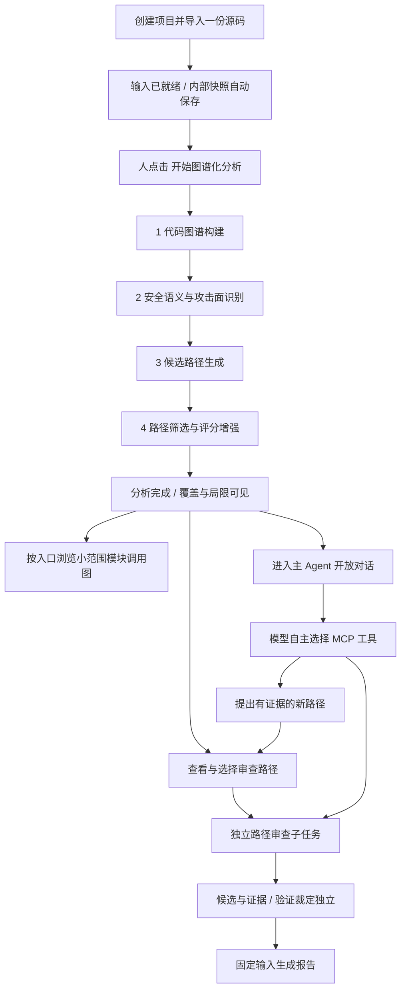
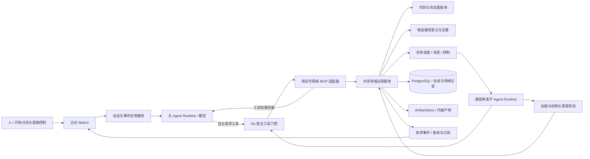
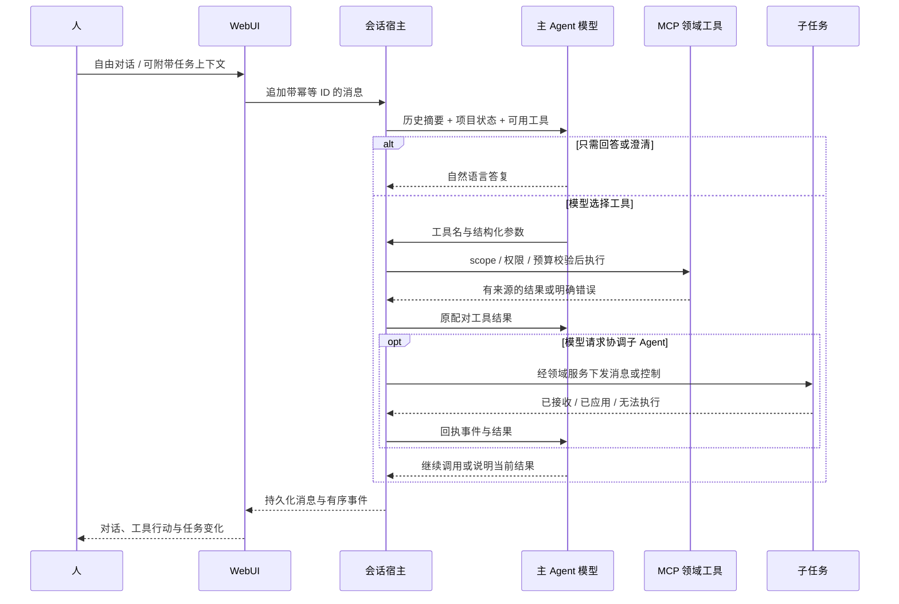
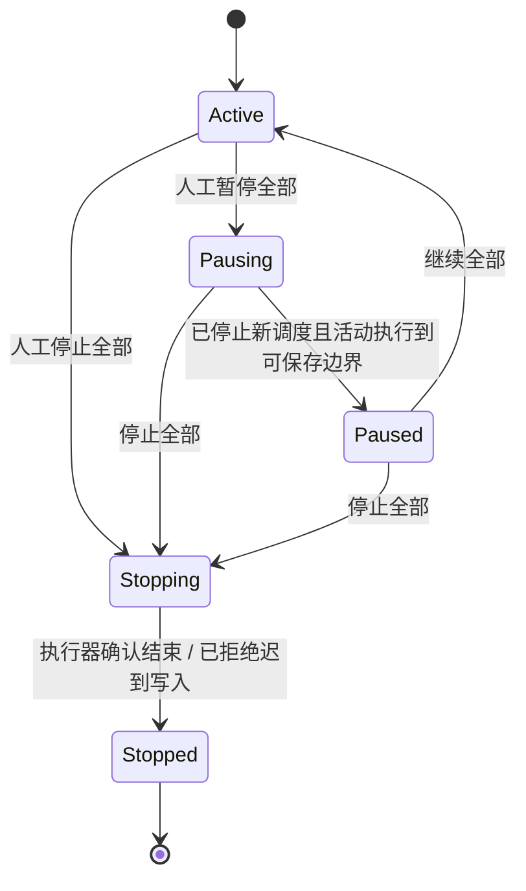

# 项目审计与主 Agent 架构

版本：2026-10-21。状态：**已确认的产品设计，按 Issue 分批接入正式系统**。

实施进展：2026-10-21 #63 已交付单源码项目输入、项目管理与可恢复删除；#28 已交付版本化能力/领域协议与适配器目录；#29 已交付确定性路径增强与筛选解释；#64 已交付项目一键四阶段 AnalysisRun；#65 已交付入口局部图谱与路径子任务；#66 已交付项目助手会话与真实 MCP 只读工具；#67–#69 仍待开发。

本文件、[实施索引](interaction-issues.md)和 [DeepSeek 接手指南](deepseek-handoff.md)是本轮开发依据。原型位于 `web/src/prototype/Journey.tsx`、`MasterWorkbench.tsx`，入口 `/prototype/`。原型展示交互，不证明后端能力已经实现；其中固定路径、定时推进、示例工具名和“播放工具调用示例”都不能搬进正式执行链。

## 1. 产品模型与工作流程

**一个新项目对应一份源码的一次审计，下属包含多个路径审查任务。** 创建时导入归档、浏览器目录或 Git 等已有来源，自动保存内部源码输入；用户不需要再创建、选择或固定快照。另一份源码创建另一项目，不增加“更新代码”入口。名称和说明可编辑。内部继续保存 snapshot、摘要、版本和证据引用，不另建昂贵的一致性子系统。

已有多来源、多快照项目保留原 ID 和历史引用，显示兼容提示，不合并、不删除、不擅自挑选 latest。新增单源码项目绑定明确的审计输入。输入导入失败或取消必须可清理，不得留下宣称就绪的项目；项目可用状态由后台记录决定。

四阶段默认只依赖传统分析工具。入口、输入、sink、控制点由解析器、框架规则与图算法标注；无法判断的业务语义、动态调用和控制有效性保留未知。Agent 辅助增强是可选能力，未开启或模型不可用不阻断默认工具链。开启时展示实际调用、预算和失败，不用模型假设覆盖静态事实。

开始分析后自动推进四阶段，持久化每阶段状态、真实进度（有分母才给百分比）、输入输出、失败原因、覆盖与截断。图谱化完成、路径筛选完成、Agent 运行结束、覆盖合同达标、漏洞确认是不同状态。

## 2. 页面职责

| 页面 | 默认信息 | 人工介入 |
|---|---|---|
| 所有项目 | 项目目录、输入就绪与阶段、任务概况 | 创建、进入项目 |
| 项目总览 | 名称、说明、源码摘要、四阶段、任务数与状态、产物、发现和报告 | 编辑管理信息、开始分析、删除项目 |
| 代码图谱 | 入口目录与搜索、默认 1–2 跳局部调用图、按需展开、源码与来源 | 选入口、改变深度、检查遗漏 |
| 审查路径 | 工具 / Agent 来源、入口与 sink、证据等级、优先级、保留 / 过滤原因 | 选择审查范围、查看证据、送入任务 |
| Agent 工作台 | 主 Agent 对话、工具行动与结果、探索 / 审查任务、执行边界 | 开放对话、附带任务上下文、直接给子 Agent 发消息、全局或单任务暂停 / 停止 |
| 发现与证据 | 候选 / 已确认分开、支持 / 反对 / 未决证据、来源 | 复核、分级；动态验证沿现有审批链 |
| 审计报告 | 版本目录、固定覆盖账本与来源、预览与下载 | 生成报告、查看局限 |

配置、插件与工作流编辑保留高级入口和已有深链接；主流程不要求用户先组装工作流。旧任务分类 / 置顶 / 归档行为继续可用，不把原型菜单当成删除后端功能的授权。图谱浏览基于已有 PostgreSQL 图查询，不要求新增 Neo4j 等数据库，也不把数据库控制台暴露给模型。

## 3. 主 Agent、子 Agent 与宿主的分工

- 人表达目标、背景、问题或纠正意见，前端不要求选择指令类型，不做关键词或枚举路由。
- 主 Agent 根据对话、项目状态和工具描述自主决定回答、澄清、调用一个或多个工具、查看结果后继续。只读问答不应强制新增路径或创建任务。
- 子 Agent 承担固定路径的证据调查和结构化回答，可回报受阻或关联路径建议；不掌握基础设施凭据，不直接管理进程。
- 主 Agent 通过 MCP 请求创建 / 调度 / 暂停 / 消息等领域动作来协调子 Agent。Go 宿主负责权限、scope、预算、并发、进程、租约、重试、取消和迟到结果栅栏。模型不持有调度器本身。
- 普通已授权工具自动执行，无“每条指令先选类型再审批计划”的通用关卡；需要扩大范围、追加额度、删除项目或动态执行等动作仍按相应领域授权办理，不能借开放对话自授权限。
- 不记录隐藏推理。展示自然语言答复、显式计划摘要、工具调用及可核查结果、指令回执和任务变化即可。

## 4. MCP 与运行时接入边界

现有 `internal/mcp/server.go` 是九个只读 SCG 工具的 stdio 服务；现有 `internal/agent/schema.go` 的 ToolDescriptor 和 Go Registry 为 llm / Pi 提供原生工具。**这两条现有链路不等于项目级主 Agent MCP 已实现。**

新项目作用域 MCP 适配器复用领域服务和同一工具描述 / 校验来源。应以真实 MCP SDK 的工具目录与调用完成集成验收；可以使用受控本地连接，不能仅把自定义 JSON 函数命名为 MCP。模型侧可以通过现有原生 tools 代理 MCP 调用，Pi 不再复制一套 TypeScript 领域逻辑。旧 `cmd/mcp` 默认仍保持只读；新增写能力必须显式、按身份与角色暴露。

| 能力示例（非冻结工具名） | 责任边界 |
|---|---|
| 项目 / 阶段 / 覆盖查询 | 项目上下文来自宿主，不能靠模型参数换项目 |
| 图谱、源码、入口、sink、未解析调用、文本搜索 | 只读、有界、返回来源与截断；复用现有图服务及 #50 / #51 |
| 候选路径提交 | 校验端点、调用边、证据引用、来源、类型、稳定身份与幂等；不伪造路径 |
| 子任务创建与调度 | 调用正式任务领域服务，共用租约、预算与并发，不直接启动任意进程 |
| 子任务消息与控制 | 带目标、消息 ID / 版本、回执和作用域；消息不静默改写历史证据 |
| 发现、报告与产物查询 | 延用现有 reader 权限及摘要检查；候选不自动提升为已确认 |

工具名称和参数是机器契约，用户意图不设枚举；工具组合不是固定工作流。使用实际 SDK 支持的 MCP 工具名，原型中的 `graph.query` 等仅作能力示意。需要数组 / 复合参数时明确升级 Schema 支持与限制，不能退回模型传 JSON 字符串或任意 Cypher/SQL/shell。

## 5. 领域对象和持久化建议

以下是目标对象，不代表已经存在对应表或 API。实施时按仓储接口与下一可用 PG 迁移号落地，不预占版本号。

| 对象 | 关键内容 |
|---|---|
| 项目审计绑定 | project_id、固定输入引用、ready / importing / failed、兼容旧项目标识 |
| 分析运行与阶段 | analysis_run_id、阶段序号 / 状态、固定工作流计划、invocation / artifact / graph revision 引用、CAS / 租约 |
| 主 Agent 会话 | session_id、project_id、输入绑定、runtime/model/config/tool pin、状态、generation、策略版本 |
| 会话消息 | message_id、session_id、角色、公开文本、可选对象引用、顺序、发送幂等键；不含命令意图枚举 |
| 主 Agent 运行 / 工具调用 | 独立 run_id / tool_call_id、参数摘要、配对结果、用量、错误、lease_epoch |
| 子任务关联 | session_id、task_id / audit_id、path_id、child_run_id、创建来源与主 Agent 请求引用 |
| 指令投递 | instruction_id、目标、发送方、内容、会话序号、expected_generation、pending / received / applied / rejected / not_applied 与原因 |
| 路径发现记录 | path_id、工具/Agent/人工来源、发现会话与调用、证据引用、knowledge pin、评分 lineage |

“项目 → 路径审查任务”的用户术语不能直接把现有 `path.Audit`（任务容器）、`AuditPath`（可领取路径）、workflow run、plugin invocation、agent run 混成一个 ID。首个切片记录显式映射；任务可以逐路径创建 audit 或通过应用服务投影已有 audit，最终必须有稳定子任务标识和可独立控制的路径。不要为适配旧 TaskBuilder 给主 Agent 伪造一条 source→sink 路径，也不将主 Agent 自然语言答复塞进路径结构化 Answer。

## 6. 生命周期和消息应用

全局暂停分别记录暂停范围与原因。继续时只恢复被该次全局暂停的任务；人工单独暂停的子任务保持暂停。停止保留记录并终止本轮 generation，新一轮指挥建立新 run / generation 或会话，不复活旧任务。界面不能请求后立即把未结束进程显示为已停止。

方向消息在下一受控模型 / 工具边界应用，暂停时可排队，目标已终态或 generation 过期则明确未应用。修正要求保留原指令和旧证据，模型应说明采纳方式或不能执行的原因，不能只由前端将消息改成已应用。主 Agent 和人直接干预同一子任务时按服务器序号与版本处理，不静默互相覆盖。重启、连接中断、并发续跑、双实例和取消迟到结果必须有真实 PG 测试。

## 7. 完成性、证据与报告

Agent 新增路径形成新的覆盖账本版本，不能修改已经冻结的 coverage_contract，也不能把旧“已完成”无提示继承到扩大后的范围。按 #47 记录合同版本、路径集合 / 账本版本、开放前沿与预算状态；如需改变合同则创建新审计轮次并保留旧轮次。报告按 #48 固定当时账本、发现和指令影响来源，后续新增路径不改写旧报告。

调用可达 ≠ 污点传播；未知控制有效性 ≠ 控制失效；高优先级 ≠ 高严重度；任务结束 ≠ 审计完成；候选 ≠ 已确认漏洞。动态验证沿 #30–#36，新增主 Agent 不取代既有审批或验证器。

## 8. 现状与实施约束

已具备：PG 持久化、认证与加密模型配置、源码导入、Go 图谱与攻击面、路径引擎、插件 / DAG / 发布、路径 Agent、Pi / llm、预算 / 检查点和固定报告。待接入：项目单源码主流程、四阶段聚合运行、当前原型图谱 / 路径页、项目级开放会话与 MCP 写工具、主子任务消息、全局控制及覆盖 / 报告扩展。

新业务仅维护 PostgreSQL；Memory 可作快速测试双，SQLite 仅旧数据读取 / 单向迁移，不能继续新增 SQLite 功能验收。保留现有 ID、API、已固定插件 / 计划 / 图谱版本和历史证据。所有新操作走认证 API、领域服务和持久化，正式失败绝不回退原型。原型里尚未展示的失败、权限、预算与重启状态必须在正式页面补齐。
