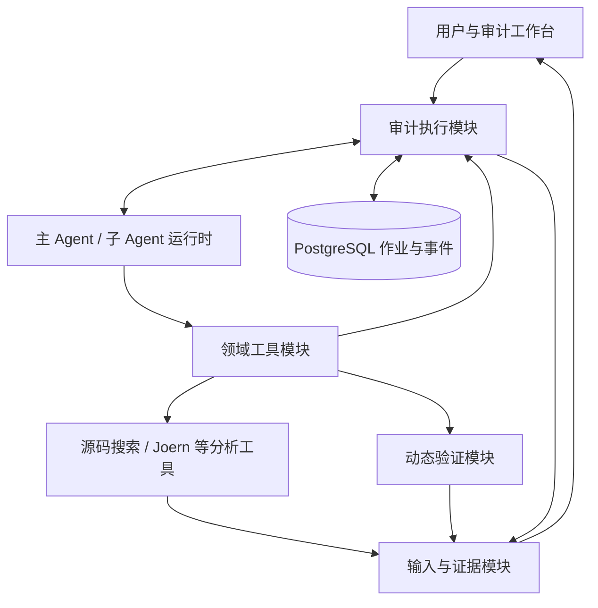

# Cod3xplo1t 重构方案

日期：2026-11-16；R0 实施更新：2026-11-17。状态：R0 已完成；R1 最小自主审计实施中。真实 DSF 已对 Grafana 8.3.0 / 8.3.1 完成独立源码调查并保留原始会话证据，产品内容器验证与报告裁定仍待贯通。

用户已确认产品目标：**主 Agent 自主协调调查和子任务，包含动态复现与验证。** 用户同时要求关闭全部旧 Issue；旧单关闭表示结束原待办路线，不代表实现或验收通过。关闭结果见本文末尾。

## 1. 目标与首版范围

把“一次自主审计”作为主对象：用户给出源码、目标和授权范围，主 Agent 自主探索、委派、调整调查方向，按需调用静态分析和动态验证，输出可追溯的候选、验证结果、证据与报告。

首版交付一条完整流程：固定输入 → 主 Agent 调查 → 真实子 Agent → 已授权的单服务容器验证 → 证据与报告 → 停止及重启恢复。R0 已固定 Go 开源应用 Grafana 8.3.0 与修复版 8.3.1，对应 CVE-2021-43798（CWE-22）；后续 R0/R1 对照持续使用该程序，除非有明确的替代决策。

首版部署沿用 Go 控制端与 PostgreSQL，复用已有受控执行器。执行 worker 可先与控制端部署在同一主机。当前重构不以切换编程语言、模型 SDK、数据库或引入分布式工作流框架为前置条件。

| 保留并验证复用 | 优先替换或收拢 | 后置扩展 |
|---|---|---|
| 不可变输入、内容摘要、产物和历史报告 | 一次审计的父子作业、控制与恢复协议 | 通用工作流编辑器的新功能 |
| 项目权限、可信审批、执行 scope | 主 Agent 的领域工具及稳定回执 | 第二套运行时的全功能对齐 |
| PostgreSQL、CAS、幂等、owner/epoch 栅栏 | 运行中消息与真实应用回执 | VM、跨主机 worker 注册和多供应器 |
| Joern、源码搜索和已有事实查询 | 验证计划、环境、执行和证据的正式流程 | 独立对象存储、插件市场泛化 |
| finding/evidence 账本与来源记录 | 面向用户的统一审计工作台 | 未校准置信度分数、复杂 CVE 模板 |

后置功能是否重启，由真实用例决定；旧编号不再决定开发顺序。已有历史数据和可用读取能力按迁移策略保留。

## 2. 架构：四个核心模块

四个模块是职责划分，实施时优先收拢已有实现，不预先建立四套新框架。

| 模块 | 对外接口承担的行为 | 实施起点 |
|---|---|---|
| 审计执行 | 创建审计、创建/等待子作业、消息、暂停/继续/取消、恢复、状态与事件读取 | 新增聚焦的 `internal/audit`；从 supervisor、reviewbatch、schedule、workflow 中逐条迁入主线编排 |
| 领域工具 | 工具目录、参数与结果 Schema、项目权限、幂等请求、稳定回执；调用明确的领域接口 | 复用 MCP 注册与现有工具；逐步替代主流程依赖自由 map 的 `project_api` |
| 输入与证据 | 固定源码、内容读取、产物校验、观察/候选身份、证据引用、固定报告输入 | 复用 repository、artifact、findings、reporting 等实现；保留一个账本 |
| 动态验证 | 校验计划和授权、创建目标环境、运行验证、收集观察、派生结论、清理与回收 | 复用 verify、container 与已实现的租约/审批机制，接通正式操作流程 |

主 Agent 决定调查内容、工具组合、委派与下一步；宿主决定调用是否合法、资源能否执行、写入是否有效。执行器种类用于宿主分派，不用于关键词识别用户意图或固定模型工具顺序。

SCG → ASG → AuditPath 继续作为一种分析能力。源码读取、文本搜索与已有线索验证可以独立进行；静态图谱未完成或 PARTIAL 时，主 Agent 能读取真实局限并选择其他调查手段。

## 3. 一次审计的统一身份与事实来源

新增审计根运行，固定源码、用户目标、授权策略、模型配置与工具版本。子作业可以是 Agent 调查、静态查询、环境验证或报告采集；每次执行有独立 attempt。

| 对象 | 必须保存的事实 |
|---|---|
| AuditRun | 根运行 ID、project/input、原始目标、policy/config/tool pins、当前版本、事件序号 |
| WorkItem | work ID、parent ID、执行器种类、目标、输入引用、状态、当前 attempt、结果引用 |
| Attempt | attempt ID、owner、lease epoch/deadline、开始/结束、错误分类、checkpoint |
| Instruction | message ID、目标 work/attempt、发送者、序号、期望版本、received/applied/rejected 回执 |
| Evidence / Finding | 沿用现有账本的身份、来源和不可变引用，关联新作业；保留模型猜想与平台结论的区别 |

作业与有序事件在同一事务提交。数据库是持久状态来源，内存只保存活动执行器和取消句柄。所有迟到写入都核对 owner、epoch、attempt 和当前状态。

共用的执行状态为 QUEUED、RUNNING、PAUSING、PAUSED、CANCELLING、SUCCEEDED、FAILED、CANCELLED。等待授权/输入等原因作为明确字段记录；结果完整度和审计覆盖独立记录。一个作业 SUCCEEDED 不等于整个项目审计完整。

验证环境继续单独记录存在状态与 cleanup 状态。作业结束不伪装环境已销毁；未回收资源仍可查询、重试清理，并阻止有关删除。

## 4. Agent 工具与上下文

首批领域工具覆盖：读取源码/搜索、查询静态证据、创建调查子作业、发送方向消息、等待/读取结果、提交候选、申请验证、读取验证证据和生成报告。名称和数量在实施时对照现有注册表确定，避免一次暴露所有 HTTP 路由。

每个工具定义固定输入/输出 Schema、权限、幂等语义、同步或异步行为、错误分类和详情读取位置。宿主注入 project、input、parent run 与操作者身份。

写工具的完整回执先于大正文返回，至少包含 `receipt_id`、真实资源或 work ID、attempt、state、version 和 result/detail 引用。完整输出放入产物，通过有界读取取得；POST 成功不依赖模型从正文尾部寻找新 ID。

主 Agent 和子 Agent 沿用现有模型调用实现及设置管理。首版主会话沿用当前 llm 路径；已有 Pi 路径执行可作为适配器接入，暂不为每个新特性复制第二套编排。采用相同的工具定义与宿主执行语义。

完整公开历史持久化，模型上下文使用有界源码窗口、结果摘要和可回读引用；保留工具调用/结果合法配对与已成功写入的回执。记录实际用量和重复失败，不把协议猜测消耗当作有效调查。

主会话保持与路径 Audit 累计 token 账本解耦的当前方向；子作业仍受宿主授予的资源约束。上下文、输出、工具结果和失败重试保持有界，成本以真实完成结果评估。

## 5. 主子协调、控制与恢复

- 子 Agent 收到目标、固定输入、相关证据和权限范围，使用真实运行时完成调查；主 Agent 可以并发安排独立工作并引用其结果。
- 方向消息持久化后返回 pending，执行器接收后给 received，并在受控模型/工具边界记录 applied 或 rejected 与理由。终态或旧 attempt 的消息不会静默施加到新执行。
- 项目级暂停先阻止新工作，在可保存位置收束活动执行。继续只恢复本次全局暂停的工作，单独人工暂停的子作业保持原状。
- 取消向整棵所属作业树传播；完成的证据保持不变。用户看到取消请求与执行确认的区别，旧 lease 和旧 attempt 的结果不能改写新状态。
- 重启时根据数据库租约恢复或接管；读取并复用已成功回执。未知进度的动态副作用先查询环境与执行状态，无法证明安全续跑时标记中断并从新 attempt 开始。
- checkpoint 保存目标、完成/待办、证据和回执 ID、未结束操作及下一动作。恢复不是重新发送整段历史后猜测执行到哪里。

首次实现先满足单控制端的真实恢复与取消，再用现有 PostgreSQL 栅栏验证第二实例接管；双实例不会引入另一套主线调度协议。

## 6. 动态验证与结论

执行链固定为：候选与证据 → 固定验证计划 → 策略/可信授权检查 → 环境供应 → 执行与观察 → 宿主校验 → 证据与结论 → 清理记录。

普通已授权范围内的动作自动执行，扩大目标、网络或能力时沿现有可信授权方式处理。模型不持有宿主管理 socket 或基础设施管理凭据。Agent 工具沙箱与被测目标环境分别建模。

首版支持一个单服务目标和一种真实 Docker 环境：固定源码和镜像、只读审计输入、独立 scratch、受控命令/PoC 产物、实际施加的资源与网络策略、TTL、取消和幂等销毁。需要目标构建时，在授权的环境中建立工作副本，冻结输入保持不变。

模型输出是候选。平台 confirmed 需要实际执行记录、有效的结构化断言及可核对来源的证据；静态路径、模型解释或单一退出码不能独立完成确认。不满足断言或环境条件时保留 inconclusive/blocked，支持 refuted 的反证须明确。既有历史 verdict 不因新实现上线被重新解释。

首个验收样本包含有漏洞版本及对应安全版本；由测试 oracle 判断验证信号。验证器本身的错误、目标未就绪和清理失败分别可见。

## 7. 分阶段交付与退出条件

阶段按完整用户行为推进。每阶段包含真实实现、必要契约/PG 持久化、认证入口、正式页面、文档与验收，完成后才把下一阶段设为活跃开发。

| 阶段 | 用户获得的行为 | 退出条件 |
|---|---|---|
| R0：基线与测量 | 能明确当前可用能力，比较结果不会被统计口径误导 | 修复 `rates()` 的 candidate/refuted 记账；safe/undecidable/edge 分开；混淆矩阵回归通过；固定源码、样本与当前配置；实际开发分支运行 CI；形成简短的当前能力矩阵 |
| R1：最小自主审计 | 给定源码与目标，主 Agent 调查并委派一个真实子 Agent，完成容器验证和可读报告 | 真实模型自主选工具；writer/reader 与 scope 生效；作业和证据在 PG 可读；漏洞样本满足验证断言，安全版本不被确认；前端可追踪整条链，失败呈现真实原因 |
| R2：协作与可靠执行 | 多子任务并行、方向纠正、全局/单任务控制，中断后继续 | 至少两个独立子作业真实并发；消息有应用回执；人工单独暂停可保留；取消等待执行确认；杀进程/重启/租约接管不重复成功写入、不接受旧结果；环境清理有审计记录 |
| R3：真实仓库与诊断 | 在主要目标栈的大型真实项目上可调查、解释缺口、继续验证已有线索 | 修正影响输入的上下文排除规则；Joern PARTIAL/前端失败/输出拒绝保留脱敏诊断；大结果与写回执可读取；产物格式正确；覆盖缺失、工具失败和空目录状态清楚；完整真实主线验收 |
| R4：旧入口迁移 | 创建、路径审查、批次、工作流和主会话使用一致控制语义 | 新运行只由一个所有者消费；旧 scheduler/workflow 不竞争同一队列；旧结果与报告可读；活动旧运行安全收束；备份恢复演练后逐项目切换默认；原 UI 兼容入口复用新实现 |
| R5：效果与成本 | 用可重复结果决定是否扩展语言、引擎或环境 | 固定已知漏洞/安全版本集，比较静态工具、Agent 不用图谱、Agent 使用图谱；重复运行并披露失败/阻塞；得到可追溯的质量、耗时和 token 基线，再决定后置功能 |

R0 只处理进入首条主线所需的测量与基线；不会先建设通用执行平台再等待用户流程。R1 直接贯通真实单例，后续可靠性在同一条主线持续扩展。

## 8. 第一条验收用例

用户在正式页面导入小型服务，输入开放审计目标。主 Agent 读取源码并自主选择调查与委派，子 Agent 返回带来源的候选；主 Agent 通过已授权计划安排验证，页面展示真实环境和执行记录，报告链接到固定源码与证据。

同一输入的安全版本走相同过程，不能得到相同的 confirmed。再分别注入目标未就绪、工具响应丢失、主进程硬停和环境清理失败，确认状态、回执与恢复符合事实。

脚本模型用于故障和协议回归；真实模型用于自主选工具和纠正行为；真实容器用于执行/隔离/清理；真实 PG 用于持久化和接管。各自证据分别标注，不能互相代替。

## 9. 迁移与开发纪律

1. 当前源码和 WIP 先形成清单与可运行基线，按现有授权管理提交/分支，保留无关改动。
2. 新模块复用已有存储、授权和执行实现，逐项迁入行为；新增持久化只面向 PostgreSQL。历史 SQLite 继续只读兼容。
3. 每个运行明确选择旧执行路径或新路径，新旧执行器对同一工作互斥。旧活动运行按原 pin 收束；读取接口通过适配器兼容历史 ID。
4. 数据迁移先备份并核对数量、关键 ID、引用和摘要；保留旧证据/报告的原字节。回退前暂停新写入并核对 schema 与版本条件，避免盲目降级。
5. 活跃开发保持一个用户切片。必要的新 Issue 在实施范围确定后再建，当前不重新批量发布未来任务。底层部分完成继续标明实验状态。
6. 交付验证沿仓库现有 TDD、相关测试、完整竞态、契约、前端、PG、lint 和涉及生命周期的 stress 约定执行。每次明确未运行项目与原因，不用排除失败包的结果替代全量结论。

质量指标按漏洞身份计算，避免一条缺陷的多路径重复计数。候选召回/精确率、正确排除、弃权/执行失败、环境可用性、独立验证成立率、真实成立发现的总 token 和端到端耗时分开报告；blocked 样本始终保留在总体结果中。质量阈值在 R0 固定，后续按同一口径比较。

## 10. 文档与历史入口

本文是本轮重构方案入口，尚不表示技术选择已全部批准或功能已实现。后续方案变更集中在本文；能力的当前状态由 R0 的能力矩阵记录，历史设计通过日期和 superseded 指向保留。

- [当前源码评估与已复现的评测问题](project-refactor-assessment-20261116.md)
- [当前能力矩阵与固定 R0 样本](current-capability-matrix.md)
- [同类项目与一手来源对照](security-audit-platform-comparison-20261116.md)
- [开发入口](agents/issue-tracker.md)

旧 Issue 和旧设计仅用于查阅约束、失败案例与已有授权。动态执行范围仍由当前明确授权和实际策略决定，旧单关闭不扩大任何执行权限。

## 11. 旧 Issue 关闭记录

2026-11-16 已关闭本次剩余的 25 个开放 Issue，均为 `CLOSED / not_planned`，每条附有维护者指令与重构方向说明。GitHub 全量状态回读为 117 个 Issue、0 个开放。此前已经关闭的 92 个 Issue 保持原状态。

原正文、讨论和已有验收记录继续保留。当前实现缺陷不会因旧单关闭而被视为修复；需要进入新主线的行为按本文重新划定切片。当前没有创建替代 Issue。

| 旧 Issue | 历史主题 | 关闭说明 |
|---|---|---|
| [#19](https://github.com/UserB1ank/Cod3xplo1t/issues/19) | 独立产物容器保存与恢复源码和分析结果 | [重构重置说明](https://github.com/UserB1ank/Cod3xplo1t/issues/19#issuecomment-6918110946) |
| [#20](https://github.com/UserB1ank/Cod3xplo1t/issues/20) | PostgreSQL 备份恢复与旧 SQLite 数据单向迁移演练 | [重构重置说明](https://github.com/UserB1ank/Cod3xplo1t/issues/20#issuecomment-6918112467) |
| [#21](https://github.com/UserB1ank/Cod3xplo1t/issues/21) | 通过受控容器 Worker 执行扫描插件 | [重构重置说明](https://github.com/UserB1ank/Cod3xplo1t/issues/21#issuecomment-6918115144) |
| [#27](https://github.com/UserB1ank/Cod3xplo1t/issues/27) | 服务启动创建真实示例项目并沿新项目流程展示 | [重构重置说明](https://github.com/UserB1ank/Cod3xplo1t/issues/27#issuecomment-6918116596) |
| [#30](https://github.com/UserB1ank/Cod3xplo1t/issues/30) | 在候选详情生成并审批绑定环境要求的固定验证计划 | [重构重置说明](https://github.com/UserB1ank/Cod3xplo1t/issues/30#issuecomment-6918118094) |
| [#31](https://github.com/UserB1ank/Cod3xplo1t/issues/31) | 通过环境供应插件创建并销毁真实容器验证环境 | [重构重置说明](https://github.com/UserB1ank/Cod3xplo1t/issues/31#issuecomment-6918119624) |
| [#32](https://github.com/UserB1ank/Cod3xplo1t/issues/32) | 在授权容器环境验证单服务候选并基于真实证据派生裁定 | [重构重置说明](https://github.com/UserB1ank/Cod3xplo1t/issues/32#issuecomment-6918121400) |
| [#33](https://github.com/UserB1ank/Cod3xplo1t/issues/33) | 验证带数据库依赖的多服务目标并恢复已知基线 | [重构重置说明](https://github.com/UserB1ank/Cod3xplo1t/issues/33#issuecomment-6918123071) |
| [#34](https://github.com/UserB1ank/Cod3xplo1t/issues/34) | 重启或 worker 失联后回收验证环境并拒绝旧执行结果 | [重构重置说明](https://github.com/UserB1ank/Cod3xplo1t/issues/34#issuecomment-6918124610) |
| [#35](https://github.com/UserB1ank/Cod3xplo1t/issues/35) | 用第二种虚拟机供应器复用同一验证工具完成真实验证 | [重构重置说明](https://github.com/UserB1ank/Cod3xplo1t/issues/35#issuecomment-6918126450) |
| [#36](https://github.com/UserB1ank/Cod3xplo1t/issues/36) | 固定报告展示验证环境、结构化断言与完整证据链 | [重构重置说明](https://github.com/UserB1ank/Cod3xplo1t/issues/36#issuecomment-6918127987) |
| [#67](https://github.com/UserB1ank/Cod3xplo1t/issues/67) | 主 Agent 自主探索并通过 MCP 提交可追溯的新审查路径 | [重构重置说明](https://github.com/UserB1ank/Cod3xplo1t/issues/67#issuecomment-6918129571) |
| [#68](https://github.com/UserB1ank/Cod3xplo1t/issues/68) | 主 Agent 通过 MCP 调度子 Agent 并传递开放对话与纠正要求 | [重构重置说明](https://github.com/UserB1ank/Cod3xplo1t/issues/68#issuecomment-6918131059) |
| [#69](https://github.com/UserB1ank/Cod3xplo1t/issues/69) | 项目级暂停停止与主子 Agent 重启恢复形成一致生命周期 | [重构重置说明](https://github.com/UserB1ank/Cod3xplo1t/issues/69#issuecomment-6918132626) |
| [#81](https://github.com/UserB1ank/Cod3xplo1t/issues/81) | [P1] 主 Agent 操作目录缺请求契约，创建工作流依赖错误字段枚举 | [重构重置说明](https://github.com/UserB1ank/Cod3xplo1t/issues/81#issuecomment-6918134267) |
| [#82](https://github.com/UserB1ank/Cod3xplo1t/issues/82) | [P1] 大型 POST 响应截断丢失 plan_id，主 Agent 无法继续创建任务 | [重构重置说明](https://github.com/UserB1ank/Cod3xplo1t/issues/82#issuecomment-6918136231) |
| [#84](https://github.com/UserB1ank/Cod3xplo1t/issues/84) | [P1] 源码导入误排除 Java vendor/target/build 包，造成真实审计输入缺失 | [重构重置说明](https://github.com/UserB1ank/Cod3xplo1t/issues/84#issuecomment-6918137869) |
| [#85](https://github.com/UserB1ank/Cod3xplo1t/issues/85) | [P2] 输出契约拒绝丢失真实执行诊断，Kotlin 失败只有笼统错误 | [重构重置说明](https://github.com/UserB1ank/Cod3xplo1t/issues/85#issuecomment-6918139269) |
| [#87](https://github.com/UserB1ank/Cod3xplo1t/issues/87) | [P2] 报告页混淆空目录与读取失败，未构图错误缺少中文引导 | [重构重置说明](https://github.com/UserB1ank/Cod3xplo1t/issues/87#issuecomment-6918140916) |
| [#88](https://github.com/UserB1ank/Cod3xplo1t/issues/88) | [P2] 产物页把 Joern 原生 CPG 下载为 TAR 扩展名 | [重构重置说明](https://github.com/UserB1ank/Cod3xplo1t/issues/88#issuecomment-6918142856) |
| [#105](https://github.com/UserB1ank/Cod3xplo1t/issues/105) | CVE 审计范围排除测试与生成目录并记录覆盖 | [重构重置说明](https://github.com/UserB1ank/Cod3xplo1t/issues/105#issuecomment-6918144765) |
| [#107](https://github.com/UserB1ank/Cod3xplo1t/issues/107) | 将有证据的 hypothesis 归档为结构化 finding 候选 | [重构重置说明](https://github.com/UserB1ank/Cod3xplo1t/issues/107#issuecomment-6918146392) |
| [#108](https://github.com/UserB1ank/Cod3xplo1t/issues/108) | 按证据置信度对 sink 簇确定性排序 | [重构重置说明](https://github.com/UserB1ank/Cod3xplo1t/issues/108#issuecomment-6918148129) |
| [#109](https://github.com/UserB1ank/Cod3xplo1t/issues/109) | 按 code-audit-system 模板生成版本化 CVE 审计报告 | [重构重置说明](https://github.com/UserB1ank/Cod3xplo1t/issues/109#issuecomment-6918150132) |
| [#110](https://github.com/UserB1ank/Cod3xplo1t/issues/110) | CVE 报告固定呈现覆盖缺口且不将未覆盖视为安全 | [重构重置说明](https://github.com/UserB1ank/Cod3xplo1t/issues/110#issuecomment-6918152159) |
